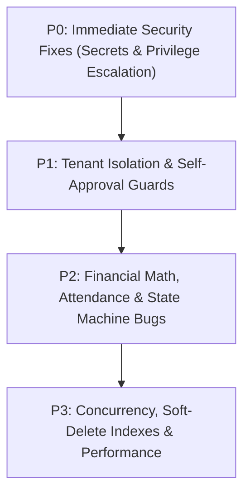

# ReviveHRSystem — Backend Security & Logic Audit Report

> [!IMPORTANT]
> This report consolidates a full-stack static analysis of the **ReviveHRSystem** backend (`Core`, `Infrastructure`, `ReviveHRSystem.Web`, and `Shared`). Every finding has been verified directly against the source code and includes exact file links, line numbers, impact analysis, and concrete remediation steps.

---

## Executive Summary

The backend demonstrates strong foundational engineering in several areas: centralized permission resolution (`AccessControlService`), SHA-256 hashed refresh tokens with `xmin` optimistic concurrency, constant-time password verification (`CryptographicOperations.FixedTimeEquals`), path-traversal protection in `LocalFileStorage`, and per-request session validation (`IsSessionAllowedAsync`).

However, our deep audit uncovered **48 distinct issues** across security, authorization, financial math, concurrency, and state machines:

| Severity | Security & Access Control | Business Logic & Data Integrity | Total |
| :--- | :---: | :---: | :---: |
| 🔴 **CRITICAL** | 6 | 7 | **13** |
| 🟠 **HIGH** | 8 | 10 | **18** |
| 🟡 **MEDIUM** | 5 | 8 | **13** |
| 🟢 **LOW** | 2 | 2 | **4** |
| **Total** | **21** | **27** | **48** |

---

## Part 1: Security & Access Control Vulnerabilities

### 🔴 CRITICAL Security Findings

#### S-C1. Hardcoded JWT Signing Key & PostgreSQL Superuser Credentials in Source Control
- **File:** [appsettings.json](file:///d:/Youssef/Projects/_Hr%20System/ReviveHRSystem/ReviveHRSystem.Web/appsettings.json#L3-L8)
- **Code:**
  ```json
  "ConnectionStrings": {
    "DefaultConnection": "Host=localhost;Port=5432;Database=ReviveHrSystemDb;Username=postgres;Password=123"
  },
  "Jwt": {
    "Key": "2a131d47d501ae1b6ec5e789c6997626a8796f45ea859e00338e011d42fd59d93165f24e67395848b2476c148c90a64e"
  }
  ```
- **Why it matters:** Anyone with read access to the repository (or build artifacts) possesses the symmetric HMAC-SHA256 signing key and can forge valid JWTs for any `uid`, `gymId`, and `userType: "TopManagement"`, bypassing authentication and authorization completely.
- **Fix:** Remove secrets from `appsettings.json`, rotate the signing key immediately, and load `Jwt:Key` and `ConnectionStrings:DefaultConnection` from environment variables or a secret manager (`dotnet user-secrets` in development).

---

#### S-C2. Vertical Privilege Escalation via Self-Permission / Self-Role Assignment & Custom Role Creation
- **File:** [RoleService.cs](file:///d:/Youssef/Projects/_Hr%20System/ReviveHRSystem/Core/Service/Services/RoleService.cs#L74-L113) & [RoleService.cs](file:///d:/Youssef/Projects/_Hr%20System/ReviveHRSystem/Core/Service/Services/RoleService.cs#L254-L294)
- **Code:**
  ```csharp
  public async Task<UserAssignmentResponse> ReplaceUserPermissionsAsync(
      int? actorUserId, int userId, UserPermissionsRequest request, CancellationToken cancellationToken = default)
  {
      var actor = await ResolveActorAsync(actorUserId, cancellationToken);
      await _accessControl.EnsurePermissionAsync(actor.Id, "team.manage", cancellationToken);
      await EnsureUserAsync(userId, cancellationToken);
      var permissionIds = await ResolvePermissionIdsAsync(request.Permissions, cancellationToken);
      await _userAccess.ReplaceUserPermissionsAsync(userId, permissionIds, cancellationToken);
  ```
- **Why it matters:**
  1. `ReplaceUserPermissionsAsync`, `ReplaceUserRolesAsync`, and `ReplaceUserGymAccessAsync` never check `actor.Id != userId`. Any user holding `team.manage` (such as a Branch Manager or HR user) can call `PUT /api/users/{theirOwnId}/permissions` or `PUT /api/users/{theirOwnId}/roles` to grant themselves **every permission in the catalog** (including `payroll.approve`) and access to **every gym**.
  2. `CreateRoleAsync` and `SetRolePermissionsAsync` allow any `team.manage` holder to bundle permissions they do not personally hold into a role and assign that role to themselves.
  3. None of `ReplaceUserPermissionsAsync`, `ReplaceUserRolesAsync`, or `ReplaceUserGymAccessAsync` write an `AuditLog` entry.
- **Fix:**
  - Block self-assignment (`if (actor.Id == userId) throw new BadRequestException(...)`).
  - Enforce grant-ceiling validation: an actor (unless `TopManagement`) may only grant permissions that are a subset of their own effective permissions, and may only grant gym access for gyms they themselves can access.
  - Record `AuditLog` entries for all role, permission, and gym-access mutations.

---

#### S-C3. System-Wide Privilege Tampering & DoS via Preset Role Mutation/Archival
- **File:** [RoleService.cs](file:///d:/Youssef/Projects/_Hr%20System/ReviveHRSystem/Core/Service/Services/RoleService.cs#L115-L210) & [EmployeeAccessService.cs](file:///d:/Youssef/Projects/_Hr%20System/ReviveHRSystem/Core/Service/Services/EmployeeAccessService.cs#L24-L31)
- **Code:**
  ```csharp
  // RoleService.cs L120-126
  var role = await GetRoleAsync(roleId, cancellationToken);
  var name = NormalizeRequiredName(request.Name, "Role name");
  // ⚠️ Missing: if (role.IsPreset) throw new BadRequestException(...);
  role.Name = name;
  ```
- **Why it matters:**
  1. `UpdateRoleAsync`, `SetRolePermissionsAsync`, and `ArchiveRoleAsync` never check `role.IsPreset`. A `team.manage` holder in a single branch can strip all permissions from `"Super Admin"` or `"HR Manager"`, or inject `payroll.approve` into `"Team Leader"` across **all gyms**.
  2. Several services (`EmployeeAccessService`, `ShiftManagementService`, `BranchActionsService`, `FaceBiometricService`) perform authorization checks by comparing role names against hardcoded string constants (`"Team Leader"`, `"Branch Manager"`, `"Super Admin"`). Renaming a preset role immediately breaks access control across the entire platform, while naming a custom low-privilege role `"Branch Manager"` grants unauthorized access in those services.
- **Fix:** Block renaming, archiving, or mutating preset roles (`if (role.IsPreset)`) unless explicitly allowed by a dedicated system-level invariant, and replace role-name string checks with permission-key checks.

---

#### S-C4. Vertical Privilege Escalation via Recruitment Hire Wizard (`HireCoreAsync`)
- **File:** [RecruitmentService.cs](file:///d:/Youssef/Projects/_Hr%20System/ReviveHRSystem/Core/Service/Services/RecruitmentService.cs#L1187-L1257)
- **Code:**
  ```csharp
  var user = new User
  {
      UserName = email,
      Email = email,
      PasswordHash = _passwordHasher.Hash(NullIfBlank(request.Password) ?? DefaultNewAccountPassword),
      UserType = UserType.Employee,
      IsActive = true,
  };
  // ...
  if (NullIfBlank(request.Role) is string roleName)
  {
      var role = (await _unitOfWork.GetRepository<Role, int>()
              .GetAllAsync(new RoleByNameSpec(roleName), cancellationToken))
          .FirstOrDefault();
      // ...
      await _userAccess.ReplaceUserRolesAsync(user.Id, [role.Id], cancellationToken);
  }
  ```
- **Why it matters:** Any user with `recruitment.hire.approve` (which does not require `team.manage`) can hire a candidate via `POST /api/applications/{id}/hire` (or waiting-list assign), supply a known `request.Password`, and pass `Role: "Super Admin"` or `"HR Manager"`. `HireCoreAsync` assigns the requested role without checking whether the actor holds `team.manage` or whether the target role exceeds the actor's privilege level.
- **Fix:** Restrict role assignment in `HireCoreAsync` to non-privileged employee presets or enforce the same privilege-ceiling check required in `RoleService`.

---

#### S-C5. Cross-Tenant Account Takeover via Unscoped Password Reset & User Management
- **File:** [RoleService.cs](file:///d:/Youssef/Projects/_Hr%20System/ReviveHRSystem/Core/Service/Services/RoleService.cs#L587-L651)
- **Code:**
  ```csharp
  public async Task<MessageResponse> ResetUserPasswordAsync(int? actorUserId, int userId, ResetUserPasswordRequest request, CancellationToken cancellationToken = default)
  {
      var actor = await ResolveActorAsync(actorUserId, cancellationToken);
      await _accessControl.EnsurePermissionAsync(actor.Id, "team.manage", cancellationToken);
      // ⚠️ No gym scope check and no target UserType / hierarchy check!
      var user = await _unitOfWork.GetRepository<User, int>().GetByIdAsync(userId, cancellationToken)
          ?? throw new NotFoundException("User not found.");
      user.PasswordHash = _passwordHasher.Hash(password);
  ```
- **Why it matters:** `ResetUserPasswordAsync`, `ChangeUserStatusAsync`, `ReplaceUserPermissionsAsync`, `ReplaceUserRolesAsync`, and `ReplaceUserGymAccessAsync` only check global `team.manage` and never verify:
  1. Whether `user` belongs to a gym managed by `actor`.
  2. Whether `user.UserType == UserType.TopManagement` (or higher privilege than `actor`).
  An HR or Branch Manager with `team.manage` in Gym A can reset the password of a **TopManagement** user or a user in Gym B, log in as them, and take over the entire platform.
- **Fix:** Verify that non-`TopManagement` actors cannot modify or reset passwords of `TopManagement` users, and verify that the target user is within the actor's gym scope.

---

#### S-C6. Hardcoded Default Password (`"Revive!2026"`) Shared Across All New Accounts
- **Files:**
  - [RoleService.cs](file:///d:/Youssef/Projects/_Hr%20System/ReviveHRSystem/Core/Service/Services/RoleService.cs#L33)
  - [EmployeeService.cs](file:///d:/Youssef/Projects/_Hr%20System/ReviveHRSystem/Core/Service/Services/EmployeeService.cs#L42)
  - [RecruitmentService.cs](file:///d:/Youssef/Projects/_Hr%20System/ReviveHRSystem/Core/Service/Services/RecruitmentService.cs#L45)
- **Code:**
  ```csharp
  private const string DefaultNewAccountPassword = "Revive!2026";
  ```
- **Why it matters:** Every newly created HR user, employee, and bulk-imported employee receives the exact same static password `"Revive!2026"`, with no `MustChangePasswordOnLogin` flag. Anyone who knows this constant can log into any newly created account before the owner changes their password. (Meanwhile, `EmployeeManagementService.cs` L79 generates a random password `Guid.NewGuid().ToString("N")[..12] + "A1"` and discards it without returning or emailing it, making accounts created via that path impossible to log into.)
- **Fix:** Generate a cryptographically random temporary password or one-time invite token per account, deliver it securely, and enforce a mandatory password change on first sign-in.

---

### 🟠 HIGH Security Findings

#### S-H1. Password Change & Admin Password Reset Do Not Revoke Active Refresh Tokens
- **Files:**
  - [NotificationService.cs (`AccountSettingsService.ChangePasswordAsync`)](file:///d:/Youssef/Projects/_Hr%20System/ReviveHRSystem/Core/Service/Services/NotificationService.cs#L408-L427)
  - [RoleService.cs (`ResetUserPasswordAsync`)](file:///d:/Youssef/Projects/_Hr%20System/ReviveHRSystem/Core/Service/Services/RoleService.cs#L627-L651)
- **Why it matters:** When a user changes their password or an administrator resets a user's password after a suspected compromise, neither method revokes the user's active `RefreshToken` rows. An attacker holding a stolen refresh token can continue rotating tokens and minting new JWT access tokens for up to 30 days after the password change.
- **Fix:** Call `_userSessions.RevokeAllRefreshTokensAsync(user.Id)` (or revoke all active refresh tokens for `userId`) inside both `ChangePasswordAsync` and `ResetUserPasswordAsync`.

---

#### S-H2. Self-Approval Vulnerabilities Across Payroll, Requests, Action Escalations, Bonuses, and Evaluations
- **Files:**
  - [PayrollService.cs](file:///d:/Youssef/Projects/_Hr%20System/ReviveHRSystem/Core/Service/Services/PayrollService.cs#L290-L400) (`AddDeductionAsync`, `UpdateBonusAsync`, `CloseEntryAsync`, `ApprovePeriodAsync`)
  - [RequestService.cs](file:///d:/Youssef/Projects/_Hr%20System/ReviveHRSystem/Core/Service/Services/RequestService.cs#L266-L435) (`DecideRequestAsync`)
  - [ActionRequestService.cs](file:///d:/Youssef/Projects/_Hr%20System/ReviveHRSystem/Core/Service/Services/ActionRequestService.cs#L99-L271) (`ApproveAsync`)
  - [BranchActionsService.cs](file:///d:/Youssef/Projects/_Hr%20System/ReviveHRSystem/Core/Service/Services/BranchActionsService.cs#L500-L568) (`ReviewWarningAsync`, `ReviewBonusAsync`)
  - [EvaluationService.cs](file:///d:/Youssef/Projects/_Hr%20System/ReviveHRSystem/Core/Service/Services/EvaluationService.cs#L566-L605) (`SubmitResponseAsync`)
- **Why it matters:** While `RequestManagementService` and `BranchActionsService` carefully exclude the actor's own employee record when *raising* branch items, the **HR approval/execution endpoints** do not check whether the actor is approving their own record:
  - A user with `payroll.edit` / `payroll.approve` can add a bonus to their own `PayrollEntry`, close it, and approve the period.
  - A user with `requests.approve` can approve their own leave, salary advance, overtime, or bonus proposal in `RequestService.DecideRequestAsync` and `BranchActionsService.ReviewBonusAsync`.
  - In `ActionRequestService`, creating an escalation (`CreateAsync`) and approving it (`ApproveAsync`) require the **exact same permission key** (`EventsService.PermissionKeyOfActionType(actionType)`), with no check that `request.RequestedById != actor.Id` or `request.Employee?.UserId != actor.Id`.
  - In `EvaluationService.SubmitResponseAsync`, `DispatchAsync` excludes `e.UserId != evaluator.Id`, but `SubmitResponseAsync` / `ResolveSubjectAsync` does not — allowing an evaluator to submit a `100` score evaluation for themselves.
- **Fix:** Enforce separation of duties across all approval/evaluation writes: reject requests where `targetEmployee.UserId == actor.Id` or `requestedById == actor.Id` (unless explicitly overridden by a separate `TopManagement` account).

---

#### S-H3. Cross-Gym Tenant Isolation Bypass in `EvaluationService` (Forms, Hiring Forms, Dispatch, Goals, Cycles)
- **File:** [EvaluationService.cs](file:///d:/Youssef/Projects/_Hr%20System/ReviveHRSystem/Core/Service/Services/EvaluationService.cs#L66-L191), [EvaluationService.cs](file:///d:/Youssef/Projects/_Hr%20System/ReviveHRSystem/Core/Service/Services/EvaluationService.cs#L274-L507), & [EvaluationService.cs](file:///d:/Youssef/Projects/_Hr%20System/ReviveHRSystem/Core/Service/Services/EvaluationService.cs#L882-L979)
- **Why it matters:**
  1. `GetFormsAsync` scopes evaluation forms to the actor's gyms, **but `GetFormAsync(formId)`, `UpdateFormAsync(formId)`, `DeleteFormAsync(formId)`, `DispatchAsync(formId)`, `GetHiringFormAsync(formId)`, `UpdateHiringFormAsync(formId)`, and `DeleteHiringFormAsync(formId)` never check whether the existing `form.GymId` belongs to the actor's gym scope!** In `UpdateFormAsync` (line 127), it only validates the *new* gym from the request body, allowing a user in Gym A to overwrite, steal, dispatch, or delete forms belonging to Gym B.
  2. `DispatchAsync(formId)` (line 400) loads `ActiveEmployeesForFormSpec()` and `ActiveUsersSpec()` across **all gyms**; if `form.GymId` is `null` (an org-wide template), an HR user scoped only to Gym A dispatches assignments to evaluators and employees in Gym B, C, etc.
  3. `GetGoalsAsync` (line 916) and `GetPerformanceCyclesAsync` (line 887) have **zero gym filtering**, returning goals and cycles across all tenants.
- **Fix:** Verify `form.GymId` against the actor's resolved gym scope before reading, updating, deleting, or dispatching a form; scope `DispatchAsync`, `GetGoalsAsync`, and `CreateGoalAsync` to the actor's accessible gyms.

---

#### S-H4. Cross-Gym & Cross-Team Shift Assignment Hijacking in `ShiftCycleService.SetShiftAssignmentsAsync`
- **File:** [ShiftCycleService.cs](file:///d:/Youssef/Projects/_Hr%20System/ReviveHRSystem/Core/Service/Services/ShiftCycleService.cs#L383-L458) & [ShiftCycleService.cs](file:///d:/Youssef/Projects/_Hr%20System/ReviveHRSystem/Core/Service/Services/ShiftCycleService.cs#L553-L573)
- **Code:**
  ```csharp
  // ShiftCycleService.cs L409-419 — only checks if EmployeeId exists in DB!
  var employees = (await _unitOfWork.GetRepository<Employee, int>()
          .GetAllAsync(new EmployeesByIdsSpec(employeeIds), cancellationToken))
      .Select(e => e.Id)
      .ToHashSet();
  // ...
  // L568-570 — re-parents existing assignment from ANY cycle/gym to target.Id!
  existing.ShiftCycleId = target.Id;
  existing.ShiftTemplateId = templateId;
  ```
- **Why it matters:**
  1. Unlike `ShiftManagementService.UpdateAssignmentsAsync` (which restricts edits to `ScopedEmployeeIdsAsync`), `ShiftCycleService.SetShiftAssignmentsAsync` only checks whether `EmployeeId` exists in the `Employees` table.
  2. It does **not** verify that `employee.GymId == cycle.GymId`, nor does it enforce team scoping (`_teamScope`) for Team Leaders.
  3. Because `ShiftAssignment` has a global unique index on `(EmployeeId, Date)` and `ApplyAssignment` re-parents conflicting rows (`existing.ShiftCycleId = target.Id`), a user with `schedule.manage` in Gym A can pass `EmployeeId` of an employee in **Gym B** and steal/overwrite their published shift assignments from Gym B's schedule!
- **Fix:** Validate all `employeeIds` in `SetShiftAssignmentsAsync` against `LoadRosterEmployeesAsync(actor.Id, cycle.GymId)` (and exclude the actor's own employee ID, matching `ShiftManagementService`).

---

#### S-H5. Global Permission Fallback Bypass in `ShiftManagementService.EnsureManagementScopeAsync`
- **File:** [ShiftManagementService.cs](file:///d:/Youssef/Projects/_Hr%20System/ReviveHRSystem/Core/Service/Services/ShiftManagementService.cs#L38-L58)
- **Code:**
  ```csharp
  var permissionKeys = await userAccess.GetPermissionKeysForGymAsync(actorUserId, gymId, cancellationToken);
  if (permissionKeys.Contains("schedule.manage", StringComparer.Ordinal))
  {
      return;
  }
  ```
- **Why it matters:** Per ADR-003 (`UserAccessRepository.GetPermissionKeysForGymAsync`, lines 117–124), if a user has **no** `UserGymRole` in `gymId`, `GetPermissionKeysForGymAsync` falls back to their **global** role keys. Unlike `AccessControlService.EnsurePermissionForGymAsync`, `ShiftManagementService.EnsureManagementScopeAsync` **forgot to call `userAccess.HasGymAccessAsync(actorUserId, gymId)`**! If any caller reaches `ShiftManagementService` without a prior gym-access check, a user with global `schedule.manage` passes authorization for gyms they are not assigned to.
- **Fix:** Inject `IAccessControlService` into `ShiftManagementService` and call `await accessControl.EnsurePermissionForGymAsync(actorUserId, "schedule.manage", gymId, cancellationToken)`.

---

#### S-H6. Gym-Selection Token Shares Issuer, Audience, and Signing Key With Access Tokens
- **File:** [TokenService.cs](file:///d:/Youssef/Projects/_Hr%20System/ReviveHRSystem/Core/Service/Services/TokenService.cs#L25-L27) & [TokenService.cs](file:///d:/Youssef/Projects/_Hr%20System/ReviveHRSystem/Core/Service/Services/TokenService.cs#L64-L75)
- **Code:**
  ```csharp
  private const string SelectionAudienceSuffix = ".gym-selection"; // ← Declared, NEVER used!
  ```
- **Why it matters:** `SelectionAudienceSuffix` is dead code. `CreateGymSelectionToken` calls `CreateSignedToken` with the exact same `Issuer`, `Audience`, and `Key` as full access tokens. Separation relies solely on an event check in `Program.cs` (`HasClaim("purpose", "gym-selection")`). Additionally, selection tokens are stateless and not invalidated after `SelectGymAsync`, allowing replay within their 5-minute window.
- **Fix:** Pass `audience: settings.Audience + SelectionAudienceSuffix` when creating and validating gym-selection tokens so standard JWT audience validation rejects them cryptographically on API endpoints.

---

#### S-H7. Missing Authorization Check in `BranchActionsService.SendReportAsync` & `RequestService.ArchiveRequestAsync`
- **Files:**
  - [BranchActionsService.cs](file:///d:/Youssef/Projects/_Hr%20System/ReviveHRSystem/Core/Service/Services/BranchActionsService.cs#L441-L472)
  - [RequestService.cs](file:///d:/Youssef/Projects/_Hr%20System/ReviveHRSystem/Core/Service/Services/RequestService.cs#L663-L698)
- **Why it matters:**
  1. In `BranchActionsService`, every branch action (`IssueDeductionAsync`, `IssueWarningAsync`, `ProposeBonusAsync`) calls `await EnsureManagementScopeAsync(actorUserId, gymId, cancellationToken)` — **except `SendReportAsync`**, which performs no role or permission check at all. Any regular employee can submit fake `BranchReport` events.
  2. In `RequestService`, both `ArchiveRequestAsync` and `RestoreRequestAsync` check `"requests.view"` (a read-only permission) instead of `"requests.approve"` or `"requests.manage"`. Any user with read-only request visibility can archive pending requests.
- **Fix:** Add `await EnsureManagementScopeAsync(actorUserId, gymId, cancellationToken)` to `SendReportAsync`, and require `"requests.approve"` in `ArchiveRequestAsync` and `RestoreRequestAsync`.

---

#### S-H8. Cross-Gym Announcement Broadcast & Tampering in `NotificationService`
- **File:** [NotificationService.cs](file:///d:/Youssef/Projects/_Hr%20System/ReviveHRSystem/Core/Service/Services/NotificationService.cs#L126-L230)
- **Why it matters:**
  1. `CreateAnnouncementAsync` checks global `announcements.manage` but never validates `request.Audience` against the actor's gym scope. A manager in Gym A can broadcast to `"All Employees"` or `"Gym B"`.
  2. `UpdateAnnouncementAsync` checks global `announcements.manage` without verifying that the announcement belongs to the actor's gym scope, allowing cross-gym tampering or cancellation of org-wide announcements.
- **Fix:** Scope `CreateAnnouncementAsync` and `UpdateAnnouncementAsync` to the actor's allowed gyms via `HrPortalHelpers.ResolveGymScopeAsync`.

---

### 🟡 MEDIUM & 🟢 LOW Security Findings

| ID | Severity | Location | Issue & Remediation |
| :--- | :---: | :--- | :--- |
| **S-M1** | 🟡 Medium | [AuthService.cs](file:///d:/Youssef/Projects/_Hr%20System/ReviveHRSystem/Core/Service/Services/AuthService.cs#L41-L58) | **Lockout Counter Race Condition, No Reset on Expiry, & User Enumeration:** (1) `FailedLoginAttempts` is not reset when `LockoutEnd <= DateTime.UtcNow`, so a single failed login after lockout expiry immediately re-locks the account for another full window. (2) `User` has no concurrency token (`xmin`), allowing parallel requests to race `FailedLoginAttempts++`. (3) Returning a distinct `"temporarily locked"` message before password verification enables email enumeration. |
| **S-M2** | 🟡 Medium | [EvaluationService.cs](file:///d:/Youssef/Projects/_Hr%20System/ReviveHRSystem/Core/Service/Services/EvaluationService.cs#L570-L599) | **Team Leader Evaluation Scope Bypass:** In `SubmitResponseAsync`, a Team Leader without `evaluations.manage` passes the auth check if they have at least one `EvaluationAssignment` for `formId` (`assignmentRows.Count > 0`). However, `ResolveSubjectAsync` only checks `scope.Contains(subject.GymId)` and never verifies that `subject.Id` is in `assignmentRows` or in the Team Leader's team! |
| **S-M3** | 🟡 Medium | [RecruitmentService.cs](file:///d:/Youssef/Projects/_Hr%20System/ReviveHRSystem/Core/Service/Services/RecruitmentService.cs#L989-L1033) & [AccessControlService.cs](file:///d:/Youssef/Projects/_Hr%20System/ReviveHRSystem/Core/Service/Services/AccessControlService.cs#L49-L71) | **Null `gymId` Skips Gym Access Check in `EnsurePermissionForGymAsync`:** When a public hiring form application has an empty or unrecognized `row.Gym` string, `PreferredGymIdAsync(row.Gym)` returns `null`. Passing `gymId: null` to `EnsurePermissionForGymAsync` skips `HasGymAccessAsync`, allowing any user with `recruitment.candidates.manage` to view/reject/convert unscoped applications. |
| **S-M4** | 🟡 Medium | [PasswordHasher.cs](file:///d:/Youssef/Projects/_Hr%20System/ReviveHRSystem/Core/Service/Services/PasswordHasher.cs#L12-L15) | **PBKDF2-SHA256 Iteration Count Below OWASP 2023 Baseline:** Uses `100,000` iterations of PBKDF2-SHA256 instead of OWASP's recommended `600,000` iterations (or Argon2id). Since iteration count is stored in the hash prefix (`PBKDF2$100000$...`), you can safely bump `Iterations = 600_000` without breaking existing hashes. |
| **S-M5** | 🟡 Medium | [RoleService.cs](file:///d:/Youssef/Projects/_Hr%20System/ReviveHRSystem/Core/Service/Services/RoleService.cs#L358-L416) | **Cross-Gym Information Disclosure in `GetUserAccessProfileAsync`:** Checks only `team.view` and returns all gyms, roles, and permissions of any `userId` across the entire organization without verifying gym scope. |
| **S-L1** | 🟢 Low | [AuthService.cs](file:///d:/Youssef/Projects/_Hr%20System/ReviveHRSystem/Core/Service/Services/AuthService.cs#L398-L420) | **Unchecked Ownership on Refresh Token Logout:** `LogoutAsync` revokes `RefreshToken` by hash without verifying `stored.UserId == userId`, and revoked/expired tokens are never purged from the `RefreshTokens` table. |
| **S-L2** | 🟢 Low | [SecurityHeadersMiddleware.cs](file:///d:/Youssef/Projects/_Hr%20System/ReviveHRSystem/ReviveHRSystem.Web/Middleware/SecurityHeadersMiddleware.cs#L20-L23) & [CustomExceptionMiddleWare.cs](file:///d:/Youssef/Projects/_Hr%20System/ReviveHRSystem/ReviveHRSystem.Web/CustomMiddleWares/CustomExceptionMiddleWare.cs#L35) | **Missing HSTS Header & Log Template Anti-Pattern:** `_logger.LogError(ex, ex.Message)` passes `ex.Message` as the structured log format template (can throw `FormatException` if `ex.Message` contains `{` or `}`). Also add `Strict-Transport-Security` in production. |

---

## Part 2: Business Logic Errors, Financial Bugs & Race Conditions

### 🔴 CRITICAL Logic & Financial Findings

#### L-C1. Contradictory Daily-Rate & Overtime Formulas Cause Systematic Payroll Miscalculations
- **Files:**
  - [DeductionPricing.cs](file:///d:/Youssef/Projects/_Hr%20System/ReviveHRSystem/Core/Service/Services/DeductionPricing.cs#L15-L81)
  - [PayrollService.cs](file:///d:/Youssef/Projects/_Hr%20System/ReviveHRSystem/Core/Service/Services/PayrollService.cs#L1903-L1979)
- **Code:**
  ```csharp
  // 1) DeductionPricing.cs L15 & L78: divides by 30
  public const int StandardDays = 30;
  public static decimal DailyRate(decimal baseSalary) => baseSalary / StandardDays;

  // 2) PayrollService.cs L1958 & L1977: divides by ~26 (6 days/week)
  private const int WeeklyWorkDays = 6;
  var scheduled = Math.Max(1, (int)Math.Floor(days * WeeklyWorkDays / 7.0));

  // 3) PayrollService.cs L1905: divides by 176 (22 days × 8h, i.e., 5-day workweek!)
  entry.BaseSalary / 176m * 1.5m * entry.OvertimeHours
  ```
- **Why it matters:** The payroll engine uses **three incompatible work-month assumptions** simultaneously:
  1. **Deductions & Cover Pay** use `baseSalary / 30` (30 days/month).
  2. **Attendance Rate Display** (`AttendanceRates`) uses `baseSalary / 26` (6-day workweek = ~26 days/month).
  3. **Overtime Pay** uses `baseSalary / 176` (5-day workweek = 22 days × 8 hours), overpaying overtime by **~18%** relative to a 6-day workweek (`208` hours) or **~36%** relative to a 30-day × 8h month (`240` hours).
  Additionally, `PayrollService.cs` line 1935 uses floating-point `Math.Pow((double)(1 + percent.Value / 100m), years)` for salary compounding instead of `decimal` arithmetic, and `SyncTotals` (line 1951) allows `entry.NetPay` to become **negative** when deductions exceed gross pay.
- **Fix:** Standardize the daily/hourly divisor across `DeductionPricing` and `PayrollService`, replace `Math.Pow` with a `decimal` loop, and clamp `NetPay` (or reject deductions exceeding gross pay).

---

#### L-C2. `LateGraceMinutes` (15 min) Is Configured in `AttendanceOptions` But Never Applied on Check-In
- **Files:**
  - [AttendanceOptions.cs](file:///d:/Youssef/Projects/_Hr%20System/ReviveHRSystem/Core/Service/Services/AttendanceOptions.cs#L14)
  - [AttendanceService.cs](file:///d:/Youssef/Projects/_Hr%20System/ReviveHRSystem/Core/Service/Services/AttendanceService.cs#L68) & [AttendanceService.cs](file:///d:/Youssef/Projects/_Hr%20System/ReviveHRSystem/Core/Service/Services/AttendanceService.cs#L460)
- **Code:**
  ```csharp
  // AttendanceService.cs L68 — only EarlyLeaveGraceMinutes is read; LateGraceMinutes is ignored!
  private readonly int _earlyLeaveGraceMinutes = (attendanceOptions ?? new AttendanceOptions()).EarlyLeaveGraceMinutes;
  // ...
  // L460 — 1 second after shiftStartsAt is marked Late!
  record.Status = template is not null && localEvent > shiftStartsAt
      ? AttendanceStatus.Late
      : AttendanceStatus.OnTime;
  ```
- **Why it matters:** `AttendanceOptions.LateGraceMinutes` (default 15 minutes) is never read by `AttendanceService`. An employee checking in **1 second** after `shiftStartsAt` is immediately marked `AttendanceStatus.Late`!
- **Fix:** Apply the grace window (or the gym's `GymAttendancePolicy` grace minutes) when computing `AttendanceStatus.Late`: `localEvent > shiftStartsAt.AddMinutes(_lateGraceMinutes)`.

---

#### L-C3. Re-Check-In After Early Checkout Laundering `Late` Status to `OnTime` & Leaving Orphaned `CheckOutMethod`
- **File:** [AttendanceService.cs](file:///d:/Youssef/Projects/_Hr%20System/ReviveHRSystem/Core/Service/Services/AttendanceService.cs#L466-L475) & [AttendanceService.cs](file:///d:/Youssef/Projects/_Hr%20System/ReviveHRSystem/Core/Service/Services/AttendanceService.cs#L514-L518)
- **Code:**
  ```csharp
  // L514-518: On early checkout, Status is overwritten with EarlyCheckout (losing Late!)
  if (earlyLeave is not null)
  {
      record.Status = AttendanceStatus.EarlyCheckout;
  }
  // L466-475: On subsequent check-in the same day:
  record.CheckOutTime = null;
  if (record.Status == AttendanceStatus.EarlyCheckout && template is not null)
  {
      record.Status = AttendanceStatus.OnTime; // ← Even if original CheckInTime was Late!
  }
  ```
- **Why it matters:** If an employee arrives 2 hours late (`Status = Late`), checks out early (`Status` becomes `EarlyCheckout`), and then checks back in again, their status is unconditionally reset to **`OnTime`** — completely erasing their late arrival! Also, `record.CheckOutMethod` is not cleared when `CheckOutTime` is set back to `null`.
- **Fix:** Recompute `record.Status` from `record.CheckInTime` vs `shiftStartsAt` (with grace period) when reopening a checked-out record, and set `record.CheckOutMethod = null`.

---

#### L-C4. Separations Stage Update (`PUT /api/separations/{id}/stage`) Completely Bypasses Exit Checklist & Verdict Guards
- **File:** [SeparationsService.cs](file:///d:/Youssef/Projects/_Hr%20System/ReviveHRSystem/Core/Service/Services/SeparationsService.cs#L208-L272) vs [SeparationsService.cs](file:///d:/Youssef/Projects/_Hr%20System/ReviveHRSystem/Core/Service/Services/SeparationsService.cs#L313-L355)
- **Code:**
  ```csharp
  // FinalizeAsync (L318-326) enforces:
  if (!kase.ChecklistItems.All(i => i.IsCompleted))
      throw new BadRequestException("Complete the exit checklist before finalizing.");
  if (kase.FinalReason is null || kase.SettlementDirection is null || kase.RehireStatus is null)
      throw new BadRequestException("Save the exit verdict before finalizing.");

  // UpdateStageAsync (L223-262) when target == "Completed":
  // Auto-completes all checklist items, skips Verdict validation, and terminates the employee!
  ```
- **Why it matters:** Calling `PUT /api/separations/{id}/stage` with `{ "status": "Completed" }` force-completes every unchecked exit task (handover, uniform return, access card revocation, final settlement), skips the mandatory exit verdict (`FinalReason`, `Settlement`, `RehireStatus`), and immediately terminates the employee.
- **Fix:** Either disallow `target == "Completed"` in `UpdateStageAsync` (requiring callers to use `FinalizeAsync`), or enforce the exact same checklist and verdict guards in `UpdateStageAsync`.

---

#### L-C5. `EventsService.SyncQueueAsync` Deletes All `BranchReport` Events on Every Read & Crashes `MetaOf`
- **Files:**
  - [BranchActionsService.cs](file:///d:/Youssef/Projects/_Hr%20System/ReviveHRSystem/Core/Service/Services/BranchActionsService.cs#L457-L471)
  - [EventsService.cs](file:///d:/Youssef/Projects/_Hr%20System/ReviveHRSystem/Core/Service/Services/EventsService.cs#L46-L58) & [EventsService.cs](file:///d:/Youssef/Projects/_Hr%20System/ReviveHRSystem/Core/Service/Services/EventsService.cs#L580-L593)
- **Code:**
  ```csharp
  // EventsService.cs L588-592:
  var derivedKeys = derived.Select(DerivedKeyOf).ToHashSet();
  foreach (var stale in stored.Where(s => !derivedKeys.Contains(RowKeyOf(s))))
  {
      repo.Remove(stale); // ← Deletes every EventType.BranchReport row!
  }
  ```
- **Why it matters:**
  1. `BranchActionsService.SendReportAsync` inserts rows into the `Events` table with `Type = EventType.BranchReport`.
  2. However, `EventsService.DeriveEventsAsync` only derives 8 event types and **never includes `EventType.BranchReport`**. Consequently, the very next call to `GET /api/events` or `GET /api/events/counts` runs `SyncQueueAsync` and **deletes every `BranchReport` in the database**!
  3. Even if `SyncQueueAsync` didn't delete them, `EventsService.Metas` (lines 46–56) omits `EventType.BranchReport`, so `MetaOf(row.Type)` (`Array.Find(Metas, m => m.Type == type)!`) returns `null` and throws a `NullReferenceException` in `BuildItemsAsync` and `ResolveAsync`!
  4. Furthermore, `SyncQueueAsync` mutates the database on every `GET /api/events` and `GET /api/events/counts` request without a lock or unique constraint on `(Type, EntityType, EntityId)`. When the UI fires `/api/events` and `/api/events/counts` in parallel on page load, both requests race and insert duplicate `Event` rows.
- **Fix:** Exclude non-derived event types (`s.Type != EventType.BranchReport`) from pruning in `SyncQueueAsync`, add `EventType.BranchReport` to `EventsService.Metas` and `PermissionOf`, and add a unique filtered index on `(Type, EntityType, EntityId)` (or guard `SyncQueueAsync`).

---

#### L-C6. Soft-Delete (`IsDeleted = true`) Breaks Unique Indexes Across `Users`, `Roles`, `Employees`, and `StationCodes`
- **Files:**
  - [RevivHrDbContext.cs](file:///d:/Youssef/Projects/_Hr%20System/ReviveHRSystem/Infrastructure/Persistence/Data/RevivHrDbContext.cs#L188-L194)
  - [UserModuleConfigurations.cs](file:///d:/Youssef/Projects/_Hr%20System/ReviveHRSystem/Infrastructure/Persistence/Data/Configurations/UserModuleConfigurations.cs#L19-L40)
  - [EmployeeModuleConfigurations.cs](file:///d:/Youssef/Projects/_Hr%20System/ReviveHRSystem/Infrastructure/Persistence/Data/Configurations/EmployeeModuleConfigurations.cs#L27-L29)
  - [SchedulingAndAttendanceConfigurations.cs](file:///d:/Youssef/Projects/_Hr%20System/ReviveHRSystem/Infrastructure/Persistence/Data/Configurations/SchedulingAndAttendanceConfigurations.cs#L177-L180)
- **Why it matters:** `RevivHrDbContext.StampRecordMetadata()` intercepts `EntityState.Deleted` for every entity with an `Id` and converts it into a soft-delete (`IsDeleted = true`), while `ConfigureRecordMetadata` applies a global query filter `IsDeleted == false`.
  - However, only `ShiftAssignment`, `RequestDecision`, and `DeductionCandidate` include `.HasFilter("\"IsDeleted\" = false")` on their unique indexes!
  - `Role.Name`, `User.Email`, `User.UserName`, `Employee.EmployeeNumber`, `Employee.UserId`, `StationCode.Code`, and `StationCode.GymId` have **unfiltered** unique indexes (or only `.HasFilter("\"IsActive\" = TRUE")` on `StationCode.GymId`).
  - For example, when a role is archived (`ArchiveRoleAsync` calls `Remove`, setting `IsDeleted = true`), the global query filter hides it from `EnsureNameAvailableAsync`, which reports the name is available — and then `SaveChangesAsync` crashes with an unhandled PostgreSQL `23505 unique_violation` (`500 Internal Server Error`)!
- **Fix:** Add `.HasFilter("\"IsDeleted\" = false")` (and `"IsActive" = TRUE AND "IsDeleted" = FALSE` on `StationCode.GymId`) to all unique indexes on soft-deletable entities.

---

#### L-C7. Leave Balance Double-Spending Race Condition & Non-Transactional Reservation
- **Files:**
  - [EmployeeRequestService.cs](file:///d:/Youssef/Projects/_Hr%20System/ReviveHRSystem/Core/Service/Services/EmployeeRequestService.cs#L353-L442)
  - [LeaveBalanceReservation.cs](file:///d:/Youssef/Projects/_Hr%20System/ReviveHRSystem/Core/Service/Services/LeaveBalanceReservation.cs#L80-L120)
  - [RequestService.cs](file:///d:/Youssef/Projects/_Hr%20System/ReviveHRSystem/Core/Service/Services/RequestService.cs#L200-L260) & [RequestService.cs](file:///d:/Youssef/Projects/_Hr%20System/ReviveHRSystem/Core/Service/Services/RequestService.cs#L663-L676)
- **Why it matters:**
  1. **Check-Then-Act Race:** `EmployeeRequestService.CreateAsync` checks `EnsureDaysAvailableAsync` (line 353), calls `SaveChangesAsync` to insert the `EmployeeRequest` (line 417), and only afterwards calls `LeaveBalanceReservation.AdjustPendingDaysAsync` (line 441, which calls a second `SaveChangesAsync`). Two concurrent requests for the same employee both pass `EnsureDaysAvailableAsync` before either increments `PendingDays`, allowing an employee with 1 day left to book multiple leaves.
  2. **Orphaned Reservation on Archive:** `RequestService.ArchiveRequestAsync` (line 672) sets `entity.Status = RequestStatus.Archived` on a pending leave request **without releasing `PendingDays`**, permanently locking those leave days!
  3. **HR On-Behalf Bypass:** `RequestService.CreateRequestAsync` (line 200) creates requests on behalf of an employee without calling `EnsureDaysAvailableAsync` or reserving `PendingDays`, allowing HR to create paid leave requests even when the employee has 0 balance.
  4. **`ResolvePaymentAsync` Ignores `PendingDays`:** In `RequestService.cs` line 825, `var leftDays = balance is null ? 0 : balance.TotalEntitlement - balance.UsedDays;` forgets to subtract `balance.PendingDays`!
- **Fix:** Add `UseXminAsConcurrencyToken()` to `LeaveBalance`, combine the request creation and `PendingDays` update into a single `SaveChangesAsync` call, subtract `PendingDays` in `ResolvePaymentAsync`, and release `PendingDays` when archiving a pending request.

---

### 🟠 HIGH Logic & Data Integrity Findings

#### L-H1. Contradictory Unscheduled Attendance Day Validation Breaks Cover Days > 2
- **File:** [RequestService.cs](file:///d:/Youssef/Projects/_Hr%20System/ReviveHRSystem/Core/Service/Services/RequestService.cs#L363-L390)
- **Code:**
  ```csharp
  // Block 1 (L367-371) — allows 1..5 (MaxCoverDays = 5)
  var days = request.CalculatedDays ?? (entity.OvertimeHoursRequested is decimal oh && oh > 0 ? (int)oh : 1);
  if (days is < 1 or > RequestTypeCatalog.MaxCoverDays)
      throw new BadRequestException($"Calculated days must be between 1 and {RequestTypeCatalog.MaxCoverDays}.");
  payment = days == 1 ? "1 day" : $"{days} days";
  entity.OvertimeHoursRequested = days;

  // Block 2 (L380-390) — immediately below, rejects anything except 1 or 2!
  if (entity.Type == RequestTypeCatalog.UnscheduledAttendance && request.CalculatedDays is int days2)
  {
      if (days2 is not (1 or 2))
          throw new BadRequestException("Unscheduled attendance can be counted as 1 or 2 days.");
  ```
- **Why it matters:** Block 1 was updated to allow up to `RequestTypeCatalog.MaxCoverDays` (5 days), but the legacy Block 2 immediately below it was left behind! Any attempt to approve an Unscheduled Attendance request with `CalculatedDays` of 3, 4, or 5 passes Block 1 and immediately throws `"Unscheduled attendance can be counted as 1 or 2 days."` in Block 2.
  - Furthermore, in `AttendanceSelfService.cs` (L80) and `AttendanceManagementService.cs` (L644), cover days are only counted `if (days is 1 or 2)` and parsed via `request.Payment?.Contains("2")`, silently dropping 3–5 day approvals!
- **Fix:** Remove the duplicate Block 2 in `RequestService.cs` and update the attendance services to allow `1..RequestTypeCatalog.MaxCoverDays`.

---

#### L-H2. Excused Hours Monthly Cap Checks Combined Total Instead of Separate Late/Early Caps
- **File:** [EmployeeRequestService.cs](file:///d:/Youssef/Projects/_Hr%20System/ReviveHRSystem/Core/Service/Services/EmployeeRequestService.cs#L644-L645) & [EmployeeRequestService.cs](file:///d:/Youssef/Projects/_Hr%20System/ReviveHRSystem/Core/Service/Services/EmployeeRequestService.cs#L720-L735)
- **Code:**
  ```csharp
  // L720-722 comment:
  // "Late attendance and early leave hold separate caps, so each bucket only
  //  ever sums its own requests — a heavy late month cannot eat the early-leave allowance."
  // L644-645 actual enforcement:
  var used = usage.Total; // where Total => LateHours + EarlyHours!
  if (used + hours > cap)
  ```
- **Why it matters:** Despite computing `LateHours` and `EarlyHours` separately and explicitly documenting that they have separate caps, line 644 checks `usage.Total` (`LateHours + EarlyHours`) against the single cap!
- **Fix:** Check `isLate ? usage.LateHours : usage.EarlyHours` against `cap` in `ApplyExcusedHoursRequestAsync`.

---

#### L-H3. Overnight Shift Late-Minutes & Worked-Hours Calculation Bugs
- **Files:**
  - [AttendanceDeductionSweepService.cs](file:///d:/Youssef/Projects/_Hr%20System/ReviveHRSystem/Core/Service/Services/AttendanceDeductionSweepService.cs#L624-L629)
  - [AttendanceManagementService.cs](file:///d:/Youssef/Projects/_Hr%20System/ReviveHRSystem/Core/Service/Services/AttendanceManagementService.cs#L273-L274) & [AttendanceManagementService.cs](file:///d:/Youssef/Projects/_Hr%20System/ReviveHRSystem/Core/Service/Services/AttendanceManagementService.cs#L739-L742)
- **Code:**
  ```csharp
  // AttendanceDeductionSweepService.cs L627:
  var diff = TimeOnly.FromDateTime(checkIn) - shiftStart;
  return diff.TotalMinutes > 0 ? (int)Math.Floor(diff.TotalMinutes) : 0;

  // AttendanceManagementService.cs L741:
  var minutes = (ToMinutes(end) - ToMinutes(start) + 1440) % 1440;
  ```
- **Why it matters:**
  1. For a shift starting at `23:00`, if an employee checks in late at `00:15` (after midnight), `TimeOnly.FromDateTime(checkIn) - shiftStart` computes `00:15 - 23:00 = -22h 45m`, which is `< 0`, returning **`0` late minutes**! Overnight late arrivals after midnight are never penalized by the deduction sweep.
  2. In `AttendanceManagementService`, `ParseDayPunches` does not validate `checkOut >= checkIn` for same-day shifts, and `WorkedHours` uses `(end - start + 1440) % 1440`. If an HR user enters `checkIn: "09:00", checkOut: "08:50"` by mistake, `WorkedHours` wraps around midnight and credits the employee with **23.83 hours** of work!
- **Fix:** Compare full `DateTime` values (anchored to the shift date) in `AttendanceDeductionSweepService`, and validate punch ordering in `AttendanceManagementService`.

---

#### L-H4. `EmployeeManagementService.UpdateAsync` Validates `Status` But Never Assigns It (Dead Code) & Dual Service Surface Divergence
- **File:** [EmployeeManagementService.cs](file:///d:/Youssef/Projects/_Hr%20System/ReviveHRSystem/Core/Service/Services/EmployeeManagementService.cs#L132-L136)
- **Code:**
  ```csharp
  if (!string.IsNullOrWhiteSpace(request.Status)
      && !Enum.TryParse<EmployeeStatus>(request.Status, ignoreCase: true, out var status))
  {
      throw new BadRequestException($"Unknown employment status '{request.Status}'.");
  }
  // ⚠️ `status` is never assigned to `employee.Status`!
  ```
- **Why it matters:**
  1. `UpdateAsync` parses `request.Status` into `status` and then discards it without updating `employee.Status`.
  2. More broadly, `EmployeeManagementService` and `EmployeeService` duplicate employee creation, status changes, and employee-number generation with **incompatible behavior**: `EmployeeManagementService.ChangeStatusAsync` does **not** call `_userSessions.TerminateAccessAsync` when an employee is set to `Terminated` (leaving their sessions active until token validation checks), and does not enforce `IAccessControlService` permissions.
- **Fix:** Assign `employee.Status = status` (or delegate status changes to `ChangeStatusAsync`) and unify `EmployeeManagementService` with `EmployeeService`.

---

#### L-H5. Employee Number Generation Race Condition & Full-Table Memory Load in Three Services
- **Files:**
  - [EmployeeService.cs](file:///d:/Youssef/Projects/_Hr%20System/ReviveHRSystem/Core/Service/Services/EmployeeService.cs#L1044-L1053)
  - [EmployeeManagementService.cs](file:///d:/Youssef/Projects/_Hr%20System/ReviveHRSystem/Core/Service/Services/EmployeeManagementService.cs#L219-L232)
  - [RecruitmentService.cs](file:///d:/Youssef/Projects/_Hr%20System/ReviveHRSystem/Core/Service/Services/RecruitmentService.cs#L1660-L1669)
- **Code:**
  ```csharp
  var employees = await _unitOfWork.GetRepository<Employee, int>().GetAllAsync(cancellationToken);
  var max = employees
      .Where(e => e.EmployeeNumber.StartsWith("EMP-", StringComparison.Ordinal))
      .Select(e => int.TryParse(e.EmployeeNumber["EMP-".Length..], out var n) ? n : 0)
      .DefaultIfEmpty(1000)
      .Max();
  return $"EMP-{Math.Max(max + 1, 1001)}";
  ```
- **Why it matters:**
  1. `EmployeeService` and `RecruitmentService` load **every row in the `Employees` table into memory** (`GetAllAsync()`) on every hire just to compute `Max()`.
  2. Concurrent employee creations read the same `max` and generate the same `EMP-xxxx` number, causing a `DbUpdateException` (`500 Internal Server Error`) on the unique index `IX_Employees_EmployeeNumber`.
  3. Because `IX_Employees_EmployeeNumber` does not filter out soft-deleted rows (`IsDeleted = true`), if the highest-numbered employee is ever soft-deleted, `GetAllAsync()` hides them, `GenerateEmployeeNumberAsync()` re-generates their `EMP-xxxx` number, and **every subsequent employee creation permanently fails**!
- **Fix:** Use a PostgreSQL sequence (`CREATE SEQUENCE employee_number_seq START 1001; SELECT nextval('employee_number_seq');`) to generate employee numbers atomically in O(1) time.

---

#### L-H6. Concurrent Payroll Period & Entry Creation Race Conditions (`EnsureCurrentPeriodAsync`)
- **Files:**
  - [PayrollService.cs](file:///d:/Youssef/Projects/_Hr%20System/ReviveHRSystem/Core/Service/Services/PayrollService.cs#L133-L214)
  - [RequestAndPayrollConfigurations.cs](file:///d:/Youssef/Projects/_Hr%20System/ReviveHRSystem/Infrastructure/Persistence/Data/Configurations/RequestAndPayrollConfigurations.cs#L105)
- **Why it matters:**
  1. `PayrollPeriodConfiguration` defines a **non-unique** index: `builder.HasIndex(pp => new { pp.GymId, pp.StartDate, pp.EndDate });`.
  2. When two requests hit `EnsureCurrentPeriodAsync` concurrently at the start of a month, both see `period is null` and both insert a `PayrollPeriod` for the same gym and month, creating **duplicate payroll periods**!
  3. Similarly, concurrent calls for the same period race on the `covered` employee snapshot and insert duplicate `PayrollEntry` rows (which then throw an unhandled `DbUpdateException` 500 error).
- **Fix:** Make `IX_PayrollPeriods_GymId_StartDate_EndDate` `.IsUnique().HasFilter("\"IsDeleted\" = false")` and catch `DbUpdateException` in `EnsureCurrentPeriodAsync` to reload the winner period/entries.

---

#### L-H7. Partial-Commit Data Corruption in Multi-Step Operations (`HireCoreAsync`, `TransferAsync`, `ReplaceUserGymAccessAsync`)
- **Files:**
  - [RecruitmentService.cs (`HireCoreAsync`)](file:///d:/Youssef/Projects/_Hr%20System/ReviveHRSystem/Core/Service/Services/RecruitmentService.cs#L1187-L1323)
  - [EmployeeService.cs (`TransferAsync`)](file:///d:/Youssef/Projects/_Hr%20System/ReviveHRSystem/Core/Service/Services/EmployeeService.cs#L695-L703)
  - [UserAccessRepository.cs](file:///d:/Youssef/Projects/_Hr%20System/ReviveHRSystem/Infrastructure/Persistence/Repository/UserAccessRepository.cs#L38-L106)
- **Why it matters:** `UserAccessRepository` calls `_dbContext.SaveChangesAsync()` inside `AddGymAccessAsync`, `RemoveGymAccessAsync`, `ReplaceUserRolesAsync`, and `ReplaceUserPermissionsAsync`.
  - In `HireCoreAsync`, `User` is saved at line 1196, `Employee` is saved at line 1215, `AddGymAccessAsync` saves at line 1217, and **only at line 1250** does it validate `request.Role`. If `request.Role` is invalid, `HireCoreAsync` throws `BadRequestException` *after* the `User` and `Employee` are already committed in the database, while `application.Status` is still `InProgress`. Retrying the hire then fails permanently with `"Email '...' is already in use."`!
  - In `HireCoreAsync`, `request.LeaveDays` and `request.AnnualIncrease` are accepted in the request DTO and echoed back in `HireResponse`, **but are never saved to `LeaveBalance` or `Employee` in the database!**
- **Fix:** Validate `request.Role` **before** saving `User` and `Employee`, seed the `LeaveBalance` row when `request.LeaveDays` is provided, and wrap multi-step mutations in a database transaction (`BeginTransactionAsync`).

---

#### L-H8. Announcement Notification Correlation by Mutable Title String (`NotificationsByTitleSpec`)
- **File:** [NotificationService.cs](file:///d:/Youssef/Projects/_Hr%20System/ReviveHRSystem/Core/Service/Services/NotificationService.cs#L192-L223) & [NotificationService.cs](file:///d:/Youssef/Projects/_Hr%20System/ReviveHRSystem/Core/Service/Services/NotificationService.cs#L365-L377)
- **Code:**
  ```csharp
  // L193-196: Mutates Title FIRST
  if (title is not null)
  {
      announcement.Title = title;
  }
  // ...
  // L215-223: Searches for delivered notifications using the NEW title!
  if (announcement.Status == AnnouncementStatus.Cancelled)
  {
      var delivered = await _unitOfWork.GetRepository<Notification, int>()
          .GetAllAsync(new NotificationsByTitleSpec($"Announcement: {announcement.Title}"), cancellationToken);
  ```
- **Why it matters:**
  1. `UpdateAnnouncementAsync` mutates `announcement.Title` on line 195 **before** querying `NotificationsByTitleSpec($"Announcement: {announcement.Title}")` on line 218. If an update changes the title and cancels the announcement (or if the title was edited previously), none of the fanned-out notifications are removed!
  2. Editing an announcement's title breaks `ReadRateAsync` (line 373), which queries notifications by the current `announcement.Title`, resetting the read rate to `0%`.
  3. Two announcements with the same title collide in both `ReadRateAsync` and cancellation cleanup.
- **Fix:** Capture `var originalTitle = announcement.Title;` before mutating `announcement.Title` (and update existing notification titles when renamed), or add a nullable `AnnouncementId` foreign key to `Notification`.

---

#### L-H9. TopManagement Users Blocked From Viewing Employee Profile Photos (`GetPhotoAsync`) & `EmployeeAccessService`
- **Files:**
  - [EmployeeDocumentService.cs](file:///d:/Youssef/Projects/_Hr%20System/ReviveHRSystem/Core/Service/Services/EmployeeDocumentService.cs#L172-L194)
  - [EmployeeAccessService.cs](file:///d:/Youssef/Projects/_Hr%20System/ReviveHRSystem/Core/Service/Services/EmployeeAccessService.cs#L47-L72)
- **Code:**
  ```csharp
  // EmployeeDocumentService.cs L179-193
  // Comment says: "Top Management likewise." — but code never checks UserType.TopManagement!
  if (activeGymId.HasValue && employee.GymId == activeGymId.Value) { }
  else if (await userAccess.HasGymAccessAsync(actorUserId, employee.GymId, cancellationToken)) { }
  else
  {
      throw new NotFoundException("Employee not found.");
  }
  ```
- **Why it matters:** `TopManagement` accounts operate with `activeGymId = null` and do not rely on `UserGymAccess` rows. Both `EmployeeDocumentService.GetPhotoAsync` and `EmployeeAccessService.EnsureCanAccessAsync` forgot to check `actor.UserType == UserType.TopManagement`, causing 404 errors when Top Management views employee profiles or avatars!
- **Fix:** Add a `TopManagement` check to `EmployeeAccessService` and `EmployeeDocumentService.GetPhotoAsync`.

---

#### L-H10. Undo of Approved Requests (`UndoDecisionAsync`) Leaves Orphaned Payroll Reversals & Skips Employment History
- **File:** [RequestService.cs](file:///d:/Youssef/Projects/_Hr%20System/ReviveHRSystem/Core/Service/Services/RequestService.cs#L437-L510)
- **Why it matters:**
  1. When a `DeductionCorrection` request is approved, `ApplyDeductionCorrectionAsync` adds a reversal `PayrollEntryLineItem` to the open payroll entry. When `UndoDecisionAsync` undoes that approval, it **never removes the reversal line item** or re-syncs the payroll entry totals!
  2. Similarly, when an `Overtime` or `UnscheduledAttendance` request is approved and later undone via `UndoDecisionAsync`, any payroll side effects or Resignation `EmploymentHistory` records are not cleaned up or logged.
- **Fix:** Reverse any linked `PayrollEntryLineItem` (`l.EmployeeRequestId == entity.Id`) and call `SyncTotals` when undoing an approved request.

---

### 🟡 MEDIUM & 🟢 LOW Logic Findings

| ID | Severity | Location | Issue & Remediation |
| :--- | :---: | :--- | :--- |
| **L-M1** | 🟡 Medium | [TeamScopeService.cs](file:///d:/Youssef/Projects/_Hr%20System/ReviveHRSystem/Core/Service/Services/TeamScopeService.cs#L18-L35) & [EmployeeAccessService.cs](file:///d:/Youssef/Projects/_Hr%20System/ReviveHRSystem/Core/Service/Services/EmployeeAccessService.cs#L129-L145) | **Team-Scope Logic Flaws (Dual-Role Downgrade, Multi-Team Truncation, & Orphaned Team Leader Promotion):** (1) `GetLedTeamIdAsync` uses `.FirstOrDefault()`, locking a leader of 2 teams out of their second team. (2) If a user holds both `BranchManager` and `TeamLeader` in a gym, `IsTeamScopedAsync` returns `true` and downgrades them to team-only scope in `EmployeeAccessService`. (3) Conversely, if a user has the `TeamLeader` role in `UserGymRoles` but hasn't been assigned a `TeamLeader` row yet, `IsTeamScopedAsync` returns `false`, and `EmployeeAccessService` falls through to `ManagerRoleNames.Contains("Team Leader")`, granting them **full gym-wide access**! |
| **L-M2** | 🟡 Medium | [EmployeesProfileController.cs](file:///d:/Youssef/Projects/_Hr%20System/ReviveHRSystem/Infrastructure/Presentation/Controllers/EmployeesProfileController.cs#L35-L49) | **Route `{id}` Parameter Silently Ignored on Profile Writes:** `PUT /api/employees/{id}/contact` and `PATCH /api/employees/{id}/emergency-contact` accept `int id` in the route, ignore it completely, and overwrite the **caller's own profile** (`GetActorUserId()`). If HR or a manager tries to update employee `999`'s emergency contact, it overwrites the HR user's own emergency contact! |
| **L-M3** | 🟡 Medium | [AttendanceSelfService.cs](file:///d:/Youssef/Projects/_Hr%20System/ReviveHRSystem/Core/Service/Services/AttendanceSelfService.cs#L58) & [EmployeeService.cs](file:///d:/Youssef/Projects/_Hr%20System/ReviveHRSystem/Core/Service/Services/EmployeeService.cs#L1349) | **Timezone Mismatches (`UtcNow` vs `_attendanceTimeZone` vs `DateTime.Today`):** `AttendanceSelfService` computes `today = DateOnly.FromDateTime(DateTime.UtcNow)` while `AttendanceManagementService` uses `_attendanceTimeZone` (Cairo UTC+2), causing self-service "Today" to be wrong between 00:00 and 02:00 local time. Also, `EmployeeService.DocumentStatusDisplay` labels already-expired documents (`expiryDate < today`) as `"Expiring Soon"` because `expiryDate <= threshold` is checked without first checking `expiryDate < today`. |
| **L-M4** | 🟡 Medium | [RequestService.cs](file:///d:/Youssef/Projects/_Hr%20System/ReviveHRSystem/Core/Service/Services/RequestService.cs#L687-L693) | **Restore Request Reconstructs Wrong Status for Cancelled Requests:** `ArchiveRequestAsync` overwrites `entity.Status = RequestStatus.Archived` without storing the prior status. `RestoreRequestAsync` guesses the prior status from `Decisions`, turning a previously `Cancelled` request back into `Pending` or `PendingHRReview`. |
| **L-M5** | 🟡 Medium | [EmployeeService.cs](file:///d:/Youssef/Projects/_Hr%20System/ReviveHRSystem/Core/Service/Services/EmployeeService.cs#L431) & [EmployeeService.cs](file:///d:/Youssef/Projects/_Hr%20System/ReviveHRSystem/Core/Service/Services/EmployeeService.cs#L657-L758) | **Null-Forgiving Crash (`500`) & Missing Salary/Leave Validation:** In `EmployeeService.ChangeStatusAsync` line 431, `ParseStatusOrNull(request.Status)!.Value` throws `InvalidOperationException` (500) if `request.Status` is null/empty. Also, `AddCompensationAsync` and `UpdateLeaveBalanceAsync` accept negative salaries and negative leave balances. |
| **L-M6** | 🟡 Medium | [AttendanceDeductionSweepService.cs](file:///d:/Youssef/Projects/_Hr%20System/ReviveHRSystem/Core/Service/Services/AttendanceDeductionSweepService.cs#L44) & [BranchActionsService.cs](file:///d:/Youssef/Projects/_Hr%20System/ReviveHRSystem/Core/Service/Services/BranchActionsService.cs#L358-L362) | **Global Static Semaphore + Synchronous Sweep on Every `GET /deductions`:** `BranchActionsService.GetDeductionsAsync` runs `deductionSweep.SweepAsync` on every read, which acquires a process-wide `private static readonly SemaphoreSlim SweepGate = new(1, 1)`, serializing all requests across all gyms. |
| **L-M7** | 🟡 Medium | [RequestService.cs](file:///d:/Youssef/Projects/_Hr%20System/ReviveHRSystem/Core/Service/Services/RequestService.cs#L135-L139) & [RecruitmentService.cs](file:///d:/Youssef/Projects/_Hr%20System/ReviveHRSystem/Core/Service/Services/RecruitmentService.cs#L1618-L1635) | **Unbounded Full-Table Loads in Hot Paths:** `RequestService.GetRequestSummaryAsync` loads all `EmployeeRequest` rows into memory (`skip: 0, take: 0`); `RecruitmentService.ResolveInterviewerAsync` and `ResolveApplicationByLabelAsync` load the entire `Users` and `Candidates` tables into memory (`GetAllAsync()`). |
| **L-M8** | 🟡 Medium | [PayrollService.cs](file:///d:/Youssef/Projects/_Hr%20System/ReviveHRSystem/Core/Service/Services/PayrollService.cs#L324-L328) | **`SyncTotals` Called Before `AddAsync` Line Item Is Guaranteed in Navigation Collection:** In `AddDeductionAsync`, `await lineRepo.AddAsync(line)` sets `PayrollEntryId = entry.Id` without adding `line` to `entry.LineItems` before calling `SyncTotals(entry)`. Explicitly add `entry.LineItems.Add(line)` before `SyncTotals(entry)` to ensure `NetPay` always reflects the new line item. |
| **L-L1** | 🟢 Low | [TokenService.cs](file:///d:/Youssef/Projects/_Hr%20System/ReviveHRSystem/Core/Service/Services/TokenService.cs#L39) | **`RefreshTokenExpiresAtUtc` Computed Property Drift:** Accessing `tokenService.RefreshTokenExpiresAtUtc` twice at different points in `AuthService` produces slightly different timestamps. |
| **L-L2** | 🟢 Low | [AttendanceManagementService.cs](file:///d:/Youssef/Projects/_Hr%20System/ReviveHRSystem/Core/Service/Services/AttendanceManagementService.cs#L659-L673) | **Attendance `BuildTotals` Switch Omits Leave/Scheduled/Cover Statuses:** `totals.Total` increments for every row, but `Present`, `Absent`, and `Off` only increment for 6 specific status strings. |

---

## Prioritized Remediation Roadmap



1. **P0 — Immediate Security (Today):**
   - Externalize `Jwt:Key` and DB credentials from `appsettings.json` (**S-C1**) and replace hardcoded `"Revive!2026"` default passwords (**S-C6**).
   - Block self-permission/role modification, enforce privilege-ceiling checks on role creation/assignment in `RoleService` and `RecruitmentService.HireCoreAsync`, and lock preset roles (`IsPreset`) from tampering (**S-C2, S-C3, S-C4, S-C5**).
   - Revoke active refresh tokens on password change/reset (**S-H1**).
2. **P1 — Tenant Isolation & Separation of Duties:**
   - Add self-approval blocks (`targetEmployee.UserId != actor.Id`) to `PayrollService`, `RequestService`, `ActionRequestService`, `BranchActionsService`, and `EvaluationService` (**S-H2**).
   - Add gym-scope checks to `EvaluationService`, `ShiftCycleService.SetShiftAssignmentsAsync`, `ShiftManagementService`, and `NotificationService` (**S-H3, S-H4, S-H5, S-H8**).
   - Fix `TopManagement` access in `EmployeeAccessService` and `EmployeeDocumentService.GetPhotoAsync` (**L-H9**).
3. **P2 — Core Business Logic & Financial Accuracy:**
   - Unify daily-rate and overtime divisors across `DeductionPricing` and `PayrollService` (**L-C1**).
   - Apply `LateGraceMinutes` on check-in and fix re-check-in status laundering in `AttendanceService` (**L-C2, L-C3**).
   - Enforce checklist/verdict completion in `SeparationsService.UpdateStageAsync` (**L-C4**).
   - Fix `EventsService.SyncQueueAsync` deleting `BranchReport` rows and crashing `MetaOf` (**L-C5**).
   - Remove the duplicate `1 or 2` cover-day check in `RequestService` and fix the separate Late/Early excused-hours cap in `EmployeeRequestService` (**L-H1, L-H2**).
4. **P3 — Database Integrity & Concurrency:**
   - Add `.HasFilter("\"IsDeleted\" = false")` to all unique indexes on soft-deletable entities (**L-C6**).
   - Add unique index on `PayrollPeriods` and `xmin` concurrency token on `LeaveBalance` and `User`, and switch `EMP-xxxx` generation to a DB sequence (**L-C7, L-H5, L-H6**).
