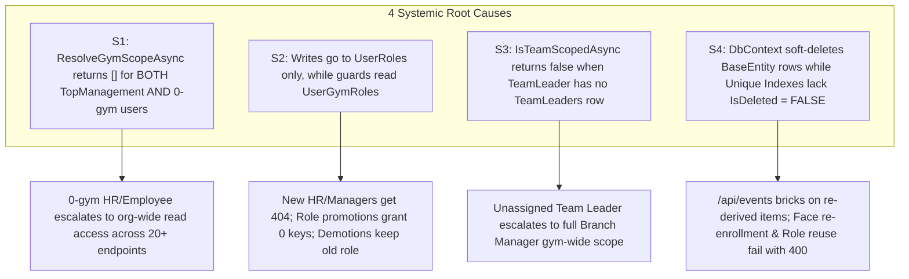

# ReviveHRSystem Backend Logic Audit

A full read-only code audit was performed across all layers of the .NET 8 backend (`DomainLayer`, `ServiceAbstraction`, `Service`, `Persistence`, `Biometrics`, `Storage`, `Presentation`, and `ReviveHRSystem.Web`).

> [!IMPORTANT]
> This report focuses strictly on **genuine business-logic, state-machine, calculation, persistence, and authorization/isolation errors** verified directly in the C# source code. No files were modified.

---

## Summary Overview

| Category / Module | Critical | High | Medium | Total |
| :--- | :---: | :---: | :---: | :---: |
| **1. Systemic / Cross-Cutting Architecture** | 4 | — | — | **4** |
| **2. Auth, Users, Roles & Session Security** | 2 | 4 | 2 | **8** |
| **3. Attendance, Biometrics, Kiosk & Scheduling** | 6 | 7 | 3 | **16** |
| **4. Requests, Leave Balances & Payroll** | 3 | 10 | 6 | **19** |
| **5. Employees, Offboarding & Recruitment** | 2 | 6 | 6 | **14** |
| **6. Evaluations, Reports, Dashboards & Notifications** | 3 | 5 | 4 | **12** |
| **Total Distinct Findings** | **20** | **32** | **21** | **73** |

---

## 1. Systemic / Cross-Cutting Logic Errors

### 1.1 [Critical] Empty Gym-Scope Array (`[]`) Escalates Zero-Gym Users to `TopManagement` Org-Wide Access
- **Locations:**
  - [HrPortalHelpers.cs](file:///d:/Youssef/Projects/_Hr%20System/ReviveHRSystem/Core/Service/Services/HrPortalHelpers.cs#L58-L80) (`ResolveGymScopeAsync`)
  - [RecruitmentService.cs](file:///d:/Youssef/Projects/_Hr%20System/ReviveHRSystem/Core/Service/Services/RecruitmentService.cs#L1495-L1517) (`ResolveGymScopeAsync`)
  - [AuthService.cs](file:///d:/Youssef/Projects/_Hr%20System/ReviveHRSystem/Core/Service/Services/AuthService.cs#L73-L78) (`LoginAsync`)
  - [UserAccessRepository.cs](file:///d:/Youssef/Projects/_Hr%20System/ReviveHRSystem/Infrastructure/Persistence/Repository/UserAccessRepository.cs#L17-L32) (`GetGymAccessAsync`)
  - Affected Specifications & Services: [RoleSpecifications.cs](file:///d:/Youssef/Projects/_Hr%20System/ReviveHRSystem/Core/Service/Specifications/RoleSpecifications.cs#L100), [ReportingSpecifications.cs](file:///d:/Youssef/Projects/_Hr%20System/ReviveHRSystem/Core/Service/Specifications/ReportingSpecifications.cs#L19-L45), [PayrollSpecifications.cs](file:///d:/Youssef/Projects/_Hr%20System/ReviveHRSystem/Core/Service/Specifications/PayrollSpecifications.cs#L15-L19), [BranchActionsSpecifications.cs](file:///d:/Youssef/Projects/_Hr%20System/ReviveHRSystem/Core/Service/Specifications/BranchActionsSpecifications.cs#L97-L122), [RecruitmentSpecifications.cs](file:///d:/Youssef/Projects/_Hr%20System/ReviveHRSystem/Core/Service/Specifications/RecruitmentSpecifications.cs#L19-L361), [EvaluationSpecifications.cs](file:///d:/Youssef/Projects/_Hr%20System/ReviveHRSystem/Core/Service/Specifications/EvaluationSpecifications.cs#L23-L106), [NotificationSpecifications.cs](file:///d:/Youssef/Projects/_Hr%20System/ReviveHRSystem/Core/Service/Specifications/NotificationSpecifications.cs#L87-L88), [EventsSpecifications.cs](file:///d:/Youssef/Projects/_Hr%20System/ReviveHRSystem/Core/Service/Specifications/EventsSpecifications.cs#L229-L289), [DashboardService.cs](file:///d:/Youssef/Projects/_Hr%20System/ReviveHRSystem/Core/Service/Services/DashboardService.cs#L359-L365), [ReportingService.cs](file:///d:/Youssef/Projects/_Hr%20System/ReviveHRSystem/Core/Service/Services/ReportingService.cs#L198-L302), [PayrollService.cs](file:///d:/Youssef/Projects/_Hr%20System/ReviveHRSystem/Core/Service/Services/PayrollService.cs#L1108-L1109)
- **Logic Flaw:**
  `ResolveGymScopeAsync` documents `null = unrestricted (Top Management without a gym filter); empty array = matches nobody`, yet its return type is non-nullable `Task<int[]>`. It returns `[]` for `TopManagement` without a filter **and** returns `allowedIds.ToArray()` — also `[]` — for any non-`TopManagement` user with zero active gyms. `AuthService.LoginAsync` only blocks `gymAccess.Count == 0` when `user.UserType == UserType.Employee` (so `HR` users log in freely with 0 gyms), and `GetGymAccessAsync` filters `g.Status == GymStatus.Active`. Every downstream spec and service checks `gymIds == null || gymIds.Length == 0` (`scope.Length == 0 ? _ => true : ...`), treating `[]` as **unrestricted org-wide visibility**.
- **Scenario:** An admin revokes an HR user's gym assignments (`PUT /api/users/{id}/gym-access` with `{"gymIds":[]}`) or marks their only assigned gym `Inactive`. Instead of seeing 0 branches, that HR user immediately sees **all payrolls, salaries, separations, candidates, evaluations, warnings, bonuses, reports, audit logs, and users across every gym in the platform**.

---

### 1.2 [Critical] Split-Brain Role Storage (`UserRoles` vs `UserGymRoles`) & Missing `TopManagement` Bypasses
- **Locations:**
  - [RoleService.cs](file:///d:/Youssef/Projects/_Hr%20System/ReviveHRSystem/Core/Service/Services/RoleService.cs#L267-L294) (`ReplaceUserRolesAsync`), [RoleService.cs](file:///d:/Youssef/Projects/_Hr%20System/ReviveHRSystem/Core/Service/Services/RoleService.cs#L553-L577) (`CreateUserAsync`)
  - [EmployeeService.cs](file:///d:/Youssef/Projects/_Hr%20System/ReviveHRSystem/Core/Service/Services/EmployeeService.cs#L835-L889) (`ChangeEmployeeRoleAsync`), [EmployeeService.cs](file:///d:/Youssef/Projects/_Hr%20System/ReviveHRSystem/Core/Service/Services/EmployeeService.cs#L1233) (`SystemRole = null`)
  - [RecruitmentService.cs](file:///d:/Youssef/Projects/_Hr%20System/ReviveHRSystem/Core/Service/Services/RecruitmentService.cs#L1245-L1257) (`HireCoreAsync`)
  - [UserAccessRepository.cs](file:///d:/Youssef/Projects/_Hr%20System/ReviveHRSystem/Infrastructure/Persistence/Repository/UserAccessRepository.cs#L81-L132) (`GetGymRoleNamesAsync`, `GetPermissionKeysForGymAsync`)
  - [EmployeeAccessService.cs](file:///d:/Youssef/Projects/_Hr%20System/ReviveHRSystem/Core/Service/Services/EmployeeAccessService.cs#L83-L148), [SessionContextService.cs](file:///d:/Youssef/Projects/_Hr%20System/ReviveHRSystem/Core/Service/Services/SessionContextService.cs#L39-L67), [AccessControlService.cs](file:///d:/Youssef/Projects/_Hr%20System/ReviveHRSystem/Core/Service/Services/AccessControlService.cs#L20-L33)
- **Logic Flaw:**
  Only startup seeders ever write to `UserGymRoles`; **zero runtime services insert, update, or delete `UserGymRoles` rows** — all runtime role mutations write exclusively to global `UserRoles`:
  1. **New HR / Manager accounts fail `EmployeeAccessService` with `404`:** Users created via `POST /api/users` or hired via `POST /api/applications/{id}/hire` have empty `UserGymRoles`, so `EmployeeAccessService.EnsureGymScopeAsync` (`GetGymRoleNamesAsync`) returns `[]` and throws `404` on employee profiles, documents, medical certificates, and self-service views.
  2. **Promotions grant 0 permissions when an `"Employee"` row exists in `UserGymRoles`:** `GetPermissionKeysForGymAsync` only falls back to `GlobalRoleKeysAsync` (`UserRoles`) when `UserGymRoles.AnyAsync(...)` is `false`. Seeded employees hold `"Employee"` (0 keys) in `UserGymRoles`, so promoting them via `POST /api/employees/{id}/role-change` or `PUT /api/users/{id}/roles` writes to `UserRoles` while `GetPermissionKeysForGymAsync` skips `GlobalRoleKeysAsync`, leaving them with 0 permissions in their gym (and `EmployeeDetailResponse.SystemRole` is hardcoded to `null` at line 1233).
  3. **Demotions never revoke permissions:** Clearing `UserRoles` leaves `UserGymRoles` (`Branch Manager` / `Team Leader`) intact, so demoted managers keep full permissions and scope.
  4. **Cross-gym permission bleed & missing `TopManagement` bypass:** `AccessControlService.EnsurePermissionAsync` checks global `UserRoles` across all gyms rather than the active gym; meanwhile `EmployeeAccessService` and `SessionContextService.SwitchGymAsync` have no `UserType.TopManagement` bypass, throwing `404`/`401` for `TopManagement` on any gym created after seeding.

---

### 1.3 [Critical] Inverted Team-Scope Resolution Escalates Unassigned Team Leaders to Full Gym Scope & Traps Dual-Role Branch Managers
- **Locations:**
  - [TeamScopeService.cs](file:///d:/Youssef/Projects/_Hr%20System/ReviveHRSystem/Core/Service/Services/TeamScopeService.cs#L18-L35) (`GetLedTeamIdAsync`, `IsTeamScopedAsync`)
  - [EmployeeAccessService.cs](file:///d:/Youssef/Projects/_Hr%20System/ReviveHRSystem/Core/Service/Services/EmployeeAccessService.cs#L24-L31) & [L127-L148](file:///d:/Youssef/Projects/_Hr%20System/ReviveHRSystem/Core/Service/Services/EmployeeAccessService.cs#L127-L148)
  - [RequestManagementService.cs](file:///d:/Youssef/Projects/_Hr%20System/ReviveHRSystem/Core/Service/Services/RequestManagementService.cs#L389-L408), [BranchActionsService.cs](file:///d:/Youssef/Projects/_Hr%20System/ReviveHRSystem/Core/Service/Services/BranchActionsService.cs#L757-L774), [AttendanceTeamRecruitmentOffboardingServices.cs](file:///d:/Youssef/Projects/_Hr%20System/ReviveHRSystem/Core/Service/Services/AttendanceTeamRecruitmentOffboardingServices.cs#L494-L511), [ShiftCycleService.cs](file:///d:/Youssef/Projects/_Hr%20System/ReviveHRSystem/Core/Service/Services/ShiftCycleService.cs#L531), [ShiftManagementService.cs](file:///d:/Youssef/Projects/_Hr%20System/ReviveHRSystem/Core/Service/Services/ShiftManagementService.cs#L356)
- **Logic Flaw:**
  1. `TeamScopeService.IsTeamScopedAsync` checks `roleNames.Contains(RoleNames.TeamLeader)` and then executes `return await GetLedTeamIdAsync(...) is not null;`. When a user holds `Team Leader` in `UserGymRoles` **without a `TeamLeaders` row** (not yet assigned to a team, or removed from leading a team), `IsTeamScopedAsync` returns `false` and `ledTeamId` is `null`. In `EmployeeAccessService` (making line 132 unreachable dead code because `ManagerRoleNames` includes `TeamLeader`), `EmployeeService`, `RequestManagementService`, `BranchActionsService`, and `OffboardingService`, that Team Leader **escalates to full gym-wide Branch Manager access** instead of failing closed.
  2. Conversely, neither `IsTeamScopedAsync` nor the `ScopedEmployeeIdsAsync` helpers check whether the user *also* holds `Branch Manager` / `HR` in that gym, trapping a promoted Branch Manager who still has a `TeamLeaders` row inside single-team scope.
  3. `GetLedTeamIdAsync` calls `.FirstOrDefault()`, locking a Team Leader assigned to 2+ teams out of all teams after the first.

---

### 1.4 [Critical] Global Soft-Delete (`IsDeleted = true`) Collides With Unfiltered Unique Indexes Across Multiple Modules
- **Locations:**
  - [RevivHrDbContext.cs](file:///d:/Youssef/Projects/_Hr%20System/ReviveHRSystem/Infrastructure/Persistence/Data/RevivHrDbContext.cs#L130-L145) & [L188-L194](file:///d:/Youssef/Projects/_Hr%20System/ReviveHRSystem/Infrastructure/Persistence/Data/RevivHrDbContext.cs#L188-L194)
  - [UnitOfWork.cs](file:///d:/Youssef/Projects/_Hr%20System/ReviveHRSystem/Infrastructure/Persistence/Repository/UnitOfWork.cs#L59-L64)
  - Unfiltered Unique Indexes:
    - `Events(Type, EntityType, EntityId)` — [CommunicationAndEvaluationConfigurations.cs](file:///d:/Youssef/Projects/_Hr%20System/ReviveHRSystem/Infrastructure/Persistence/Data/Configurations/CommunicationAndEvaluationConfigurations.cs#L108)
    - `FaceEmbeddings(EmployeeId)` — [FaceEmbeddingConfiguration.cs](file:///d:/Youssef/Projects/_Hr%20System/ReviveHRSystem/Infrastructure/Persistence/Data/Configurations/FaceEmbeddingConfiguration.cs#L24)
    - `Roles(Name)` & `Users(Email / UserName)` — [UserModuleConfigurations.cs](file:///d:/Youssef/Projects/_Hr%20System/ReviveHRSystem/Infrastructure/Persistence/Data/Configurations/UserModuleConfigurations.cs#L19-L39)
    - `AttendanceRecords(EmployeeId, Date)` & `StationCodes(Code)` — [SchedulingAndAttendanceConfigurations.cs](file:///d:/Youssef/Projects/_Hr%20System/ReviveHRSystem/Infrastructure/Persistence/Data/Configurations/SchedulingAndAttendanceConfigurations.cs#L134-L177)
    - `Employees(EmployeeNumber / UserId)` — [EmployeeModuleConfigurations.cs](file:///d:/Youssef/Projects/_Hr%20System/ReviveHRSystem/Infrastructure/Persistence/Data/Configurations/EmployeeModuleConfigurations.cs#L27-L29)
- **Logic Flaw:**
  `ReviveHrDbContext` adds shadow `IsDeleted` (`HasQueryFilter(IsDeleted == false)`) to every `BaseEntity` and intercepts `Remove(entity)` in `StampRecordMetadata()`, converting deletes into `IsDeleted = true`. However, the unique indexes above omit `.HasFilter("\"IsDeleted\" = FALSE")`. Subsequent queries see no active row (`IsDeleted == false`) and attempt to `INSERT` a fresh row, triggering PostgreSQL `23505 UniqueViolation` (caught by `UnitOfWork` as `400 "The record already exists (concurrent update)."`):
  - **HR Events Queue bricked:** When a contract/document/payroll/request leaves `EventsService.SyncQueueAsync` ([EventsService.cs](file:///d:/Youssef/Projects/_Hr%20System/ReviveHRSystem/Core/Service/Services/EventsService.cs#L589-L632)), its `Event` row is soft-deleted; if that entity ever re-enters the derivation window, **every `GET /api/events` and `GET /api/events/counts` call fails permanently with `400`**.
  - **Biometric re-enrollment bricked:** Deleting an employee's face via `DELETE /api/employees/face/{id}` ([FaceBiometricService.cs](file:///d:/Youssef/Projects/_Hr%20System/ReviveHRSystem/Infrastructure/Biometrics/FaceBiometricService.cs#L228-L234)) soft-deletes the row; re-enrolling via `POST /api/employees/face/enroll` permanently fails with `400`.
  - **Archived role names poisoned:** Archiving a role via `DELETE /api/roles/{id}` permanently blocks creating a role with that name again.

---

## 2. Authentication, Users, Roles & Session Security

### 2.1 [Critical] Cross-Gym Privilege Escalation & `TopManagement` Account Takeover in `UsersController` / `RoleService`
- **Locations:** [RoleService.cs](file:///d:/Youssef/Projects/_Hr%20System/ReviveHRSystem/Core/Service/Services/RoleService.cs#L254-L416) & [L511-L651](file:///d:/Youssef/Projects/_Hr%20System/ReviveHRSystem/Core/Service/Services/RoleService.cs#L511-L651), [UsersController.cs](file:///d:/Youssef/Projects/_Hr%20System/ReviveHRSystem/Infrastructure/Presentation/Controllers/UsersController.cs#L30-L84)
- **Logic Flaw:** Only `GetUsersAsync` scopes to the caller's gyms. None of `GetUserAccessProfileAsync`, `CreateUserAsync`, `ReplaceUserPermissionsAsync`, `ReplaceUserRolesAsync`, `ReplaceUserGymAccessAsync`, `ChangeUserStatusAsync`, or `ResetUserPasswordAsync` enforce (a) target user gym-scope isolation, (b) protection of `UserType.TopManagement` accounts, or (c) self-escalation / permission-grant ceilings.
- **Scenario:** A single-branch HR user holding `team.manage` can call `POST /api/users/1/reset-password` to overwrite the `TopManagement` Super Admin's password, or call `PUT /api/users/{ownId}/gym-access` and `PUT /api/users/{ownId}/permissions` to grant themselves all gyms and `payroll.approve`.

### 2.2 [Critical] Kiosk `StationSession` Cookie Overrides Web User's JWT `gymId` Across All Endpoints
- **Locations:** [ApiControllerBase.cs](file:///d:/Youssef/Projects/_Hr%20System/ReviveHRSystem/Infrastructure/Presentation/Controllers/ApiControllerBase.cs#L21-L28), [KioskController.cs](file:///d:/Youssef/Projects/_Hr%20System/ReviveHRSystem/Infrastructure/Presentation/Controllers/KioskController.cs#L42-L52), [Program.cs](file:///d:/Youssef/Projects/_Hr%20System/ReviveHRSystem/ReviveHRSystem.Web/Program.cs#L148-L158), [EmployeeAccessService.cs](file:///d:/Youssef/Projects/_Hr%20System/ReviveHRSystem/Core/Service/Services/EmployeeAccessService.cs#L65-L71)
- **Logic Flaw:** `KioskController.Login` sets a 30-day `HttpOnly` `StationSession` cookie on `Path = "/"`. Because `DefaultPolicy` runs both `JwtBearer` and `StationSession` handlers, both identities populate `HttpContext.User`. `ApiControllerBase.GetGymIdFromToken()` orders `User.Identities` by `.OrderByDescending(i => i.HasClaim("purpose", "station"))` — prioritizing the kiosk cookie's `gymId` over the web user's Bearer JWT `gymId`! In addition, `EmployeeAccessService.EnsureCanAccessAsync` skips `HasGymAccessAsync` when `activeGymId.HasValue`, trusting the cookie-injected `gymId`.
- **Scenario:** Any browser used to test/enroll Gym 1's kiosk retains the 30-day cookie; when an HR user or dual-gym employee signs into the web portal and switches to Gym 2, `GetGymIdFromToken()` still returns `1`, breaking Gym 2 routes (`401` on `EnsureGymScope(2)`).

### 2.3 [High] Refresh-Token Concurrency Sweep Leaves Newly Rotated Successor Tokens Alive
- **Locations:** [UserSessionService.cs](file:///d:/Youssef/Projects/_Hr%20System/ReviveHRSystem/Core/Service/Services/UserSessionService.cs#L69-L96), [AuthService.cs](file:///d:/Youssef/Projects/_Hr%20System/ReviveHRSystem/Core/Service/Services/AuthService.cs#L351-L376), [SessionContextService.cs](file:///d:/Youssef/Projects/_Hr%20System/ReviveHRSystem/Core/Service/Services/SessionContextService.cs#L108-L135)
- **Logic Flaw:** When `RevokeAllRefreshTokensAsync` (or `SwitchGymAsync` / `IssueTokensAsync`) races with a concurrent `RefreshAsync(T1 -> T2)`, `SaveChangesAsync` catches `DbUpdateConcurrencyException` (`xmin`), reloads `T1`, and saves **without re-querying `RefreshTokensByUserActiveSpec`**, leaving the newly minted successor token `T2` unrevoked and active.

### 2.4 [High] Non-Transactional Two-Save Refresh Rotation Falsely Triggers Theft Revocation on Mid-Flight Failure
- **Locations:** [AuthService.cs](file:///d:/Youssef/Projects/_Hr%20System/ReviveHRSystem/Core/Service/Services/AuthService.cs#L155-L216)
- **Logic Flaw:** `RefreshAsync` commits `stored.RevokedAtUtc` and `stored.ReplacedByTokenHash = newTokenHash` (`SaveChangesAsync` at line 181) **before** checking `gymAccess` (line 198) and **before** saving the new `RefreshToken` row (line 215) with no transaction. If step 2 fails or cancels, `stored` has `ReplacedByTokenHash != null` with no successor; retrying after 60s trips theft detection (`RevokeAllRefreshTokensAsync`), killing all of the user's other device sessions.

### 2.5 [High] Password Reset, Status Change, and Logout Session/Lockout Bugs
- **Locations:** [RoleService.cs](file:///d:/Youssef/Projects/_Hr%20System/ReviveHRSystem/Core/Service/Services/RoleService.cs#L587-L651), [AuthService.cs](file:///d:/Youssef/Projects/_Hr%20System/ReviveHRSystem/Core/Service/Services/AuthService.cs#L398-L417)
- **Logic Flaw:**
  1. `ResetUserPasswordAsync` neither revokes active refresh tokens nor resets `FailedLoginAttempts` / `LockoutEnd` (a locked-out user whose password HR just reset remains locked out).
  2. `ChangeUserStatusAsync` neither revokes refresh tokens on suspension nor blocks reactivating a `Terminated` employee's user account (`IsSessionAllowedAsync` still rejects them after `200 "Account reactivated."`).
  3. `LogoutAsync` revokes `RefreshTokenByHashSpec(hash)` without checking `stored.UserId == userId`.

### 2.6 [High] `CountUsersWithRoleAsync` Ignores `UserGymRoles` & Preset Roles Can Be Renamed/Archived
- **Locations:** [UserAccessRepository.cs](file:///d:/Youssef/Projects/_Hr%20System/ReviveHRSystem/Infrastructure/Persistence/Repository/UserAccessRepository.cs#L211-L216), [RoleService.cs](file:///d:/Youssef/Projects/_Hr%20System/ReviveHRSystem/Core/Service/Services/RoleService.cs#L115-L139) & [L192-L210](file:///d:/Youssef/Projects/_Hr%20System/ReviveHRSystem/Core/Service/Services/RoleService.cs#L192-L210)
- **Logic Flaw:** `CountUsersWithRoleAsync` counts only `UserRoles`, ignoring `UserGymRoles` — so `ArchiveRoleAsync` allows archiving roles actively held in `UserGymRoles`, silently stripping permissions via global query filters. Furthermore, neither `UpdateRoleAsync` nor `ArchiveRoleAsync` blocks modifying `role.IsPreset == true`, even though authorization services hardcode `RoleNames.*` strings (`"Team Leader"`, `"Branch Manager"`, etc.).

### 2.7 [Medium] `CustomExceptionMiddleWare` Emits `WWW-Authenticate: Bearer` on Permission Denials
- **Locations:** [CustomExceptionMiddleWare.cs](file:///d:/Youssef/Projects/_Hr%20System/ReviveHRSystem/ReviveHRSystem.Web/CustomMiddleWares/CustomExceptionMiddleWare.cs#L46-L67), [Program.cs](file:///d:/Youssef/Projects/_Hr%20System/ReviveHRSystem/ReviveHRSystem.Web/Program.cs#L242-L245)
- **Logic Flaw:** Permission/scope guards throw `UnAuthorizedException`, and `CustomExceptionMiddleWare` stamps `WWW-Authenticate: Bearer` onto **every** `401` response (contradicting `Program.cs` lines 242–245), causing the SPA to treat every permission denial as an expired JWT, rotate the refresh token, and replay the forbidden call. It also writes headers without checking `context.Response.HasStarted`.

### 2.8 [Medium] `LastLoginAt` Never Updated on Normal Logins & Stale `FailedLoginAttempts` Re-Locks on First Typo
- **Locations:** [AuthService.cs](file:///d:/Youssef/Projects/_Hr%20System/ReviveHRSystem/Core/Service/Services/AuthService.cs#L41-L59) & [L80-L95](file:///d:/Youssef/Projects/_Hr%20System/ReviveHRSystem/Core/Service/Services/AuthService.cs#L80-L95)
- **Logic Flaw:** `LoginAsync` only sets `user.LastLoginAt` inside the 2-gym employee branch (before gym selection!) and `SelectGymAsync`; single-gym employees, HR, and `TopManagement` keep `LastLoginAt = null` forever. Also, after `LockoutEnd` expires, `FailedLoginAttempts` remains `5`, so a single wrong password attempt increments to `6 >= 5` and immediately re-locks the account for 15 minutes.

---

## 3. Attendance, Biometrics, Kiosk & Scheduling

### 3.1 [Critical] Regular Employees Can Forge Biometric/Manual Punches & Read Live Roster With Web JWT
- **Locations:** [AttendanceController.cs](file:///d:/Youssef/Projects/_Hr%20System/ReviveHRSystem/Infrastructure/Presentation/Controllers/AttendanceController.cs#L34-L144), [AttendanceService.cs](file:///d:/Youssef/Projects/_Hr%20System/ReviveHRSystem/Core/Service/Services/AttendanceService.cs#L87-L157) & [L279-L282](file:///d:/Youssef/Projects/_Hr%20System/ReviveHRSystem/Core/Service/Services/AttendanceService.cs#L279-L282) & [L545-L562](file:///d:/Youssef/Projects/_Hr%20System/ReviveHRSystem/Core/Service/Services/AttendanceService.cs#L545-L562)
- **Logic Flaw:** `DefaultPolicy` accepts normal web `JwtBearer` tokens, and `GetGymIdFromToken()` falls back to the employee JWT's `"gymId"` claim. `AttendanceService` never verifies `stationSessionId is not null` on `/api/attendance/events` or `/api/attendance/face-scan`, and never checks `attendance.manual_entry` or `attendance.view` when `stationSessionId is null` on `/api/attendance/manual` (`IsHrForm == false`) or `/api/attendance/station-summary` (recording `AuditLog.UserId = null`).
- **Scenario:** Any employee with zero permissions can POST from home to `/api/attendance/events` or `/api/attendance/manual` using their normal Bearer JWT to clock themselves or any coworker IN/OUT (even backdated 24h).

### 3.2 [Critical] Continuous `AUTO` Kiosk Camera Scans Wipe `CheckOutTime` 1 Second After Checkout
- **Locations:** [AttendanceService.cs](file:///d:/Youssef/Projects/_Hr%20System/ReviveHRSystem/Core/Service/Services/AttendanceService.cs#L343-L377) & [L437-L475](file:///d:/Youssef/Projects/_Hr%20System/ReviveHRSystem/Core/Service/Services/AttendanceService.cs#L437-L475)
- **Logic Flaw:** Line 367 resolves `AUTO` via `todayHasOpenRecord || previousDayOvernightOpen is not null ? "OUT" : "IN"`. The instant an employee confirms checkout (`CheckOutTime` becomes non-null), `todayHasOpenRecord` flips to `false`. The very next camera frame (`AUTO`, `ConfirmCheckout = false`) resolves `type = "IN"`, skips the `"OUT"` confirmation gate at line 374, enters the `else` branch at line 466, and **sets `record.CheckOutTime = null`**, reopening the completed shift (`FaceScanOutcome.AlreadyComplete` is never returned anywhere).

### 3.3 [Critical] `AttendanceDeductionSweepService.LateMinutesOf` Subtracts Local `ShiftStart` From Raw UTC `CheckInTime` With Modulo-24h Wraparound
- **Locations:** [AttendanceDeductionSweepService.cs](file:///d:/Youssef/Projects/_Hr%20System/ReviveHRSystem/Core/Service/Services/AttendanceDeductionSweepService.cs#L613-L629)
- **Logic Flaw:** `CheckInTime` is stored in **UTC**, whereas `ShiftTemplate.StartTime` is **gym-local time** (`Africa/Cairo`, UTC+2/+3). `LateMinutesOf` ignores `attendanceTimeZone` and evaluates `(TimeOnly.FromDateTime(checkIn) - shiftStart).TotalMinutes`. Because `.NET`'s `TimeOnly - TimeOnly` operator wraps negative differences modulo 24 hours (`(t1 - t2 + 24h) % 24h`):
  - Checking in 10 min late at `09:10` Cairo (`07:10` UTC) for a `09:00` shift computes `07:10 - 09:00` = **`1,330` minutes (22h 10m)**, charging the `> 30 min` half-day penalty (`0.5` days) instead of 1 hour (`0.125` days) — a **4× overcharge**.
  - Checking in 140 min late at `11:20` Cairo (`09:20` UTC) for a `09:00` shift computes `09:20 - 09:00` = **`20` minutes**, undercharging `0.25` days instead of `0.5` days.

### 3.4 [Critical] `AttendanceOptions.LateGraceMinutes` Is Configured & Injected, Then Completely Ignored
- **Locations:** [AttendanceOptions.cs](file:///d:/Youssef/Projects/_Hr%20System/ReviveHRSystem/Core/Service/Services/AttendanceOptions.cs#L11-L14), [AttendanceService.cs](file:///d:/Youssef/Projects/_Hr%20System/ReviveHRSystem/Core/Service/Services/AttendanceService.cs#L68) & [L460](file:///d:/Youssef/Projects/_Hr%20System/ReviveHRSystem/Core/Service/Services/AttendanceService.cs#L460) & [L600](file:///d:/Youssef/Projects/_Hr%20System/ReviveHRSystem/Core/Service/Services/AttendanceService.cs#L600)
- **Logic Flaw:** `AttendanceService` reads `options.EarlyLeaveGraceMinutes` (line 68) but never reads `options.LateGraceMinutes` (default `15`). Line 460 (`localEvent > shiftStartsAt`) marks a check-in `08:00:01` as `Late`, triggering an automatic pay deduction.

### 3.5 [Critical] Approved `"Late Attendance"` Excused-Hours Requests Are Ignored by Punch & Deduction Sweep Logic
- **Locations:** [AttendanceService.cs](file:///d:/Youssef/Projects/_Hr%20System/ReviveHRSystem/Core/Service/Services/AttendanceService.cs#L460), [AttendanceDeductionSweepService.cs](file:///d:/Youssef/Projects/_Hr%20System/ReviveHRSystem/Core/Service/Services/AttendanceDeductionSweepService.cs#L118-L119) & [L550-L582](file:///d:/Youssef/Projects/_Hr%20System/ReviveHRSystem/Core/Service/Services/AttendanceDeductionSweepService.cs#L550-L582), [AttendanceSpecifications.cs](file:///d:/Youssef/Projects/_Hr%20System/ReviveHRSystem/Core/Service/Specifications/AttendanceSpecifications.cs#L314-L325)
- **Logic Flaw:** Unlike `"Early Leave"` (`AssessEarlyLeaveAsync`), neither `AttendanceService` nor `AttendanceDeductionSweepService` ever queries approved `"Late Attendance"` `EmployeeRequest`s — deducting **both** the employee's monthly excused-hours budget and their salary.

### 3.6 [Critical] Unpublished `Draft` & Superseded `Archived` Shift Cycles Leak Into Live Attendance & 3-Day Absence Deductions
- **Locations:** [AttendanceSpecifications.cs](file:///d:/Youssef/Projects/_Hr%20System/ReviveHRSystem/Core/Service/Specifications/AttendanceSpecifications.cs#L137-L200) & [L295-L303](file:///d:/Youssef/Projects/_Hr%20System/ReviveHRSystem/Core/Service/Specifications/AttendanceSpecifications.cs#L295-L303) & [L392-L398](file:///d:/Youssef/Projects/_Hr%20System/ReviveHRSystem/Core/Service/Specifications/AttendanceSpecifications.cs#L392-L398)
- **Logic Flaw:** None of the five `ShiftAssignment` specs in `AttendanceSpecifications.cs` filter `sa.ShiftCycle.Status == ShiftCycleStatus.Published`. Creating a **Draft** schedule immediately causes `AttendanceDeductionSweepService` to penalize unpunched Draft shifts as 3-day `"Unapproved absence"` deductions and causes stale `Archived` shifts to bleed through unassigned days.

### 3.7 [High] Hardcoded `"admin@revive.hr"` Lookup Silently Disables All Attendance Deductions When Missing
- **Locations:** [AttendanceDeductionSweepService.cs](file:///d:/Youssef/Projects/_Hr%20System/ReviveHRSystem/Core/Service/Services/AttendanceDeductionSweepService.cs#L127) & [L319-L322](file:///d:/Youssef/Projects/_Hr%20System/ReviveHRSystem/Core/Service/Services/AttendanceDeductionSweepService.cs#L319-L322) & [L660-L665](file:///d:/Youssef/Projects/_Hr%20System/ReviveHRSystem/Core/Service/Services/AttendanceDeductionSweepService.cs#L660-L665)
- **Logic Flaw:** `FindSystemUserIdAsync` queries `UserByEmailSpec("admin@revive.hr")`. In production (where `DevelopmentDataSeeder` does not run) or if Super Admin changes their email, `systemUserId` is `null` and the sweep silently generates **zero** deductions.

### 3.8 [High] `ShiftManagementService` Grants View-Only Team Leaders Full Gym-Wide Delete/Publish Rights While Blocking `schedule.view` HR Readers
- **Locations:** [ShiftManagementService.cs](file:///d:/Youssef/Projects/_Hr%20System/ReviveHRSystem/Core/Service/Services/ShiftManagementService.cs#L31-L58) & [L181-L287](file:///d:/Youssef/Projects/_Hr%20System/ReviveHRSystem/Core/Service/Services/ShiftManagementService.cs#L181-L287)
- **Logic Flaw:** `EnsureManagementScopeAsync` grants access unconditionally to any `Team Leader` role holder without checking permission keys or team scope — allowing a Team Leader (even with `schedule = View/None`) to delete the entire gym's cycle (`DELETE /api/gyms/{gymId}/shift-cycles/{id}`) or delete gym-wide shift templates (wiping `ShiftTemplateId = null` on historical assignments and soft-deleting `ScheduledShiftTemplate` on historical `AttendanceRecord`s). Meanwhile, HR users holding `schedule.view` without `schedule.manage` get `404` on GET endpoints (line 52 checks `"schedule.manage"`).

### 3.9 [High] Cross-Gym / Draft-Stealing-Published Assignment Hijacking & Unvalidated `ShiftTemplateId`
- **Locations:** [ShiftCycleService.cs](file:///d:/Youssef/Projects/_Hr%20System/ReviveHRSystem/Core/Service/Services/ShiftCycleService.cs#L185-L187) & [L409-L419](file:///d:/Youssef/Projects/_Hr%20System/ReviveHRSystem/Core/Service/Services/ShiftCycleService.cs#L409-L419) & [L553-L583](file:///d:/Youssef/Projects/_Hr%20System/ReviveHRSystem/Core/Service/Services/ShiftCycleService.cs#L553-L583), [ShiftManagementService.cs](file:///d:/Youssef/Projects/_Hr%20System/ReviveHRSystem/Core/Service/Services/ShiftManagementService.cs#L80-L96) & [L148-L176](file:///d:/Youssef/Projects/_Hr%20System/ReviveHRSystem/Core/Service/Services/ShiftManagementService.cs#L148-L176)
- **Logic Flaw:**
  1. `ShiftCycleService.SetShiftAssignmentsAsync` never verifies the employee belongs to `cycle.GymId` or the caller's team, and `ApplyAssignment` re-parents (`existing.ShiftCycleId = target.Id`) any `(EmployeeId, Date)` row globally — so editing a **Draft** cycle at Gym 2 overwrites and steals an employee's live **Published** shift at Gym 1!
  2. `ShiftManagementService.UpdateAssignmentsAsync` does zero validation on `ShiftTemplateId` (allowing cross-gym/inactive templates or crashing with `500` FK violation) and returns `Assignments = []` on fresh Draft cycles in `GetCycleAsync`.
  3. `ShiftCycleService.CreateShiftCycleAsync` rejects date overlaps against `Archived` cycles, blocking replacement schedules.

### 3.10 [High] HR Manual Entry & Correction Anchor Overnight Checkouts Before Check-In (`CheckOutTime < CheckInTime`)
- **Locations:** [AttendanceManagementService.cs](file:///d:/Youssef/Projects/_Hr%20System/ReviveHRSystem/Core/Service/Services/AttendanceManagementService.cs#L209) & [L274](file:///d:/Youssef/Projects/_Hr%20System/ReviveHRSystem/Core/Service/Services/AttendanceManagementService.cs#L274) & [L965-L990](file:///d:/Youssef/Projects/_Hr%20System/ReviveHRSystem/Core/Service/Services/AttendanceManagementService.cs#L965-L990)
- **Logic Flaw:** `ParsePunch` anchors both `checkIn` and `checkOut` to `date.ToDateTime(time)` on the same calendar date — never adding a day when an overnight shift (`22:00–05:00`) crosses midnight, never rejecting `checkOut <= checkIn`, and causing `EarlyLeaveMinutes = 1440` and auto-drafted `"Repeated early leaving"` warnings.

### 3.11 [High] After-Midnight Checkouts Fail for Unscheduled Cover Shifts & Late Evening Shifts; Rest-Day Row Blocks Multi-Gym Cover
- **Locations:** [AttendanceService.cs](file:///d:/Youssef/Projects/_Hr%20System/ReviveHRSystem/Core/Service/Services/AttendanceService.cs#L337-L368) & [L390-L415](file:///d:/Youssef/Projects/_Hr%20System/ReviveHRSystem/Core/Service/Services/AttendanceService.cs#L390-L415)
- **Logic Flaw:**
  1. `previousDayAtGym` requires `ShiftTemplate is not null`, so an unscheduled cover shift crossing midnight fails explicit `"OUT"` with `400 No check-in found for today`, while a `15:00–23:30` evening shift scanned `AUTO` at `00:05` (`EndTime > StartTime`) resolves to `"IN"` on the new day instead of closing yesterday's shift.
  2. Line 405 checks `assignments.Where(a => a.Date == eventDate)` without filtering `a.ShiftTemplateId.HasValue`, so an explicit `Off` (`ShiftTemplateId = null`) row at Gym 2 blocks unscheduled cover check-in at Gym 1 with `401 This employee is scheduled at a different branch today.`

### 3.12 [High] Terminated Staff Can Clock In & Match Face Scans; `MissingCheckout` Is Never Derived; Partial-Month Schedules Poison Sweep
- **Locations:** [AttendanceService.cs](file:///d:/Youssef/Projects/_Hr%20System/ReviveHRSystem/Core/Service/Services/AttendanceService.cs#L165-L166) & [L312-L324](file:///d:/Youssef/Projects/_Hr%20System/ReviveHRSystem/Core/Service/Services/AttendanceService.cs#L312-L324), [FaceEmbeddingSpecifications.cs](file:///d:/Youssef/Projects/_Hr%20System/ReviveHRSystem/Core/Service/Specifications/FaceEmbeddingSpecifications.cs#L22-L30), [AttendanceManagementService.cs](file:///d:/Youssef/Projects/_Hr%20System/ReviveHRSystem/Core/Service/Services/AttendanceManagementService.cs#L465-L516), [AttendanceDeductionSweepService.cs](file:///d:/Youssef/Projects/_Hr%20System/ReviveHRSystem/Core/Service/Services/AttendanceDeductionSweepService.cs#L149-L194)
- **Logic Flaw:**
  1. Terminated employees are never excluded from `AttendanceService.RecordAsync`, `StationRosterByGymDateSpec`, or `FaceEmbeddingsForGymSpec` (so terminated staff remain on kiosk rosters, can punch in, and can shadow active lookalikes during face recognition).
  2. Past open punches (`CheckInTime != null && CheckOutTime == null`) never transition or compose to `AttendanceStatus.MissingCheckout` (staying `"On Time"` forever).
  3. `AttendanceDeductionSweepService` sets `hasSchedule = true` for the **entire month** if even one 7-day cycle exists in that month, classifying all unscheduled weeks of the month as `scheduledOff` and dropping/blocking manual `Absent`/`Late` deductions on those days.

### 3.13 [High] `GymAttendancePolicyController` Locks Out `TopManagement` & Multi-Gym `HR Manager`s
- **Locations:** [GymAttendancePolicyController.cs](file:///d:/Youssef/Projects/_Hr%20System/ReviveHRSystem/Infrastructure/Presentation/Controllers/GymAttendancePolicyController.cs#L21-L30), [GymAttendancePolicyService.cs](file:///d:/Youssef/Projects/_Hr%20System/ReviveHRSystem/Core/Service/Services/GymAttendancePolicyService.cs#L60-L80)
- **Logic Flaw:** Multi-gym `HR Manager` and `TopManagement` tokens carry `gymId = null`. `EnsureGymScope` rejects `HR Manager` with `401`, and `LoadInActiveGymAsync` (`if (activeGymId is null ...)`) rejects `TopManagement` with `404 Gym not found`. Meanwhile, `UpdateAsync` checks role names rather than `attendance.edit`, letting view-only Branch Managers edit branch policy.

### 3.14 [Medium] Kiosk Login Accepts Inactive Gyms, `GetCurrentAsync` Serves Expired Codes, and Station Endpoints Skip Permission Keys
- **Locations:** [AttendanceService.cs](file:///d:/Youssef/Projects/_Hr%20System/ReviveHRSystem/Core/Service/Services/AttendanceService.cs#L888-L912), [StationCodeService.cs](file:///d:/Youssef/Projects/_Hr%20System/ReviveHRSystem/Core/Service/Services/StationCodeService.cs#L77-L93) & [L130-L139](file:///d:/Youssef/Projects/_Hr%20System/ReviveHRSystem/Core/Service/Services/StationCodeService.cs#L130-L139)
- **Logic Flaw:** `StationLoginAsync` creates sessions for `Inactive` gyms (`200 OK`, then immediately rejected by `ValidateSessionAsync`); `StationCodeService.GetCurrentAsync` returns expired 5-minute codes as active (`IsActive == true` without checking `ExpiresAtUtc`); and `EnsureCanManageStationCodesAsync` checks `UserType.HR` without any permission key.

### 3.15 [Medium] `AttendanceSelfService` & `ScheduleSelfService` Display Raw UTC Times, Skew Rates, and Hide 2nd-Gym Shifts
- **Locations:** [AttendanceMappingProfile.cs](file:///d:/Youssef/Projects/_Hr%20System/ReviveHRSystem/Core/Service/MappingProfile/AttendanceMappingProfile.cs#L23-L26), [AttendanceSelfService.cs](file:///d:/Youssef/Projects/_Hr%20System/ReviveHRSystem/Core/Service/Services/AttendanceSelfService.cs#L109-L132), [ScheduleSelfService.cs](file:///d:/Youssef/Projects/_Hr%20System/ReviveHRSystem/Core/Service/Services/ScheduleSelfService.cs#L46-L48)
- **Logic Flaw:** `AttendanceMappingProfile` extracts `TimeOnly.FromDateTime` directly from UTC timestamps (displaying 2–3h off in "My Attendance"); `AttendanceSelfService.Summarize` counts an active in-progress shift as `MissingCheckout` and ignores unpunched absences (`Rate = 100%` if 24 of 25 shifts are skipped); and `ScheduleSelfService` queries only primary `employee.GymId`, hiding a dual-gym employee's shifts at their second branch.

### 3.16 [Medium] `DeductionPricing.SalaryFor` Fallback Uses Latest Future Raise Instead of Earliest Initial Salary
- **Locations:** [DeductionPricing.cs](file:///d:/Youssef/Projects/_Hr%20System/ReviveHRSystem/Core/Service/Services/DeductionPricing.cs#L61-L64)
- **Logic Flaw:** When an incident date precedes the employee's earliest `Compensation.EffectiveDate`, the fallback sorts `.OrderByDescending(c => c.EffectiveDate).FirstOrDefault()` instead of `.OrderBy(...)`, pricing historical deductions off future promotions.

---

## 4. Requests, Leave Balances & Payroll

### 4.1 [Critical] Approved `"unpaid"` Leave Deducts 0 EGP in Payroll, Suppresses Absence Sweeps, and Allows Unlimited Annual Leave
- **Locations:** [RequestService.cs](file:///d:/Youssef/Projects/_Hr%20System/ReviveHRSystem/Core/Service/Services/RequestService.cs#L304-L318) & [L427](file:///d:/Youssef/Projects/_Hr%20System/ReviveHRSystem/Core/Service/Services/RequestService.cs#L427), [AttendanceDeductionSweepService.cs](file:///d:/Youssef/Projects/_Hr%20System/ReviveHRSystem/Core/Service/Services/AttendanceDeductionSweepService.cs#L178-L185) & [L580-L582](file:///d:/Youssef/Projects/_Hr%20System/ReviveHRSystem/Core/Service/Services/AttendanceDeductionSweepService.cs#L580-L582), [LeaveBalanceReservation.cs](file:///d:/Youssef/Projects/_Hr%20System/ReviveHRSystem/Core/Service/Services/LeaveBalanceReservation.cs#L158-L163), [PayrollService.cs](file:///d:/Youssef/Projects/_Hr%20System/ReviveHRSystem/Core/Service/Services/PayrollService.cs#L395-L451)
- **Logic Flaw:** Approving a request as `"unpaid"` returns `"Request approved · unpaid (payroll deduction)"`, yet (1) creates **no** `DeductionCandidate` or `PayrollEntryLineItem`, (2) causes `AttendanceDeductionSweepService.IsApprovedLeave` (`r.Payment == "unpaid"`) to **drop** absence deductions for those dates, (3) is never queried by `PayrollService`, paying **100% full salary**, and (4) releases `PendingDays` with `usedDelta: 0`, so `MaxDaysPerYear - UsedDays - PendingDays` resets to `12` and lets an employee with `0` accrued leave submit infinite 12-day leaves at full pay.

### 4.2 [Critical] HR-Approved `BonusProposal`s Never Flow Into Payroll
- **Locations:** [BranchActionsService.cs](file:///d:/Youssef/Projects/_Hr%20System/ReviveHRSystem/Core/Service/Services/BranchActionsService.cs#L546-L568) (`ReviewBonusAsync`), [PayrollService.cs](file:///d:/Youssef/Projects/_Hr%20System/ReviveHRSystem/Core/Service/Services/PayrollService.cs#L195-L210) & [L1913-L1914](file:///d:/Youssef/Projects/_Hr%20System/ReviveHRSystem/Core/Service/Services/PayrollService.cs#L1913-L1914)
- **Logic Flaw:** `ReviewBonusAsync` updates `proposal.Status = ProposalStatus.Approved` and saves, while `PayrollService` never queries `BonusProposals` anywhere — approved branch bonus proposals contribute `0` to `TotalBonuses`, `Gross`, and `NetPay`.

### 4.3 [Critical] Manager-Issued Non-Attendance `DeductionCandidate`s Are Silently Dropped by `PayrollService`
- **Locations:** [PayrollService.cs](file:///d:/Youssef/Projects/_Hr%20System/ReviveHRSystem/Core/Service/Services/PayrollService.cs#L423-L437) & [L556-L561](file:///d:/Youssef/Projects/_Hr%20System/ReviveHRSystem/Core/Service/Services/PayrollService.cs#L556-L561) & [L610-L615](file:///d:/Youssef/Projects/_Hr%20System/ReviveHRSystem/Core/Service/Services/PayrollService.cs#L610-L615), [BranchActionsService.cs](file:///d:/Youssef/Projects/_Hr%20System/ReviveHRSystem/Core/Service/Services/BranchActionsService.cs#L30-L38) & [L276-L288](file:///d:/Youssef/Projects/_Hr%20System/ReviveHRSystem/Core/Service/Services/BranchActionsService.cs#L276-L288)
- **Logic Flaw:** `MaterializeCandidatesAsync` skips **every** candidate (`if (deductibleDays is not null && !deductibleDays.Contains(day)) continue;`) unless that date is marked `"Absent"` or `"Late"` in attendance — even when `candidate.IsSystemGenerated == false` (`"Damaged equipment / property"`, `"Policy violation"`, `"Early checkout without approval"`, or team `Deduction` follow-ups)! Those deductions never appear in `GET /api/deduction-candidates`, never dock payroll, and stay stuck in `GET /api/branch-actions/pending-hr` forever.

### 4.4 [High] Payroll `BaseWithRaises` Double-Compounds Annual Raises Onto Latest Compensation, Applies Future Raises Early, Ignores `AnnualIncreaseAnchorDate`, Omits `NoticePeriod`/`OnLeave`, and Penalizes Post-Termination Shifts 3×
- **Locations:** [PayrollService.cs](file:///d:/Youssef/Projects/_Hr%20System/ReviveHRSystem/Core/Service/Services/PayrollService.cs#L170-L212) & [L991-L994](file:///d:/Youssef/Projects/_Hr%20System/ReviveHRSystem/Core/Service/Services/PayrollService.cs#L991-L994) & [L1920-L1936](file:///d:/Youssef/Projects/_Hr%20System/ReviveHRSystem/Core/Service/Services/PayrollService.cs#L1920-L1936), [EmployeeSpecifications.cs](file:///d:/Youssef/Projects/_Hr%20System/ReviveHRSystem/Core/Service/Specifications/EmployeeSpecifications.cs#L264-L272), [AttendanceDeductionSweepService.cs](file:///d:/Youssef/Projects/_Hr%20System/ReviveHRSystem/Core/Service/Services/AttendanceDeductionSweepService.cs#L162)
- **Logic Flaw:**
  1. `LatestCompensationSpec` lacks `EffectiveDate <= period.EndDate` (applying future-dated raises to earlier months), and `BaseWithRaises` compounds `(1 + percent/100)^years` for every year since **`HireDate`** onto that latest manual salary while ignoring `Gym.AnnualIncreaseAnchorDate` (`FixedCalendarDate` vs `HireAnniversary`).
  2. `EnsureCurrentPeriodAsync` filters `e.Status == EmployeeStatus.Active` only, excluding `NoticePeriod` and paid `OnLeave` employees.
  3. Mid-month hires/terminations have zero salary proration, while `AttendanceDeductionSweepService` (`exempt` checks only `OnLeave`/`Suspended`, not `Terminated`) charges 3-day unexcused absence penalties for every shift after termination.

### 4.5 [High] Approved `CoverPay` Omitted From `Gross`/`Net`/CSV, Plus Contradictory `1 or 2` vs `1..5` Cover-Days Validation
- **Locations:** [PayrollService.cs](file:///d:/Youssef/Projects/_Hr%20System/ReviveHRSystem/Core/Service/Services/PayrollService.cs#L980-L1025) & [L1913-L1914](file:///d:/Youssef/Projects/_Hr%20System/ReviveHRSystem/Core/Service/Services/PayrollService.cs#L1913-L1914), [RequestService.cs](file:///d:/Youssef/Projects/_Hr%20System/ReviveHRSystem/Core/Service/Services/RequestService.cs#L367-L389)
- **Logic Flaw:** `PayrollService` calculates `CoverPay` on payslips and list items, but `GrossOf(entry)` only sums `BaseSalary + TotalBonuses + OvertimePay(entry)` — omitting `CoverPay` from `Gross`, `NetPay`, and CSV exports. Meanwhile, `RequestService.DecideRequestAsync` validates `days` in `1..5` at line 368 and then throws `400 "Unscheduled attendance can be counted as 1 or 2 days."` at line 385 whenever `record is not null` (and `AttendanceManagementService`/`AttendanceSelfService` also ignore 3–5 cover days).

### 4.6 [High] `TimeOnly.AddHours(24)` Is a No-Op — Breaking Overnight `EarlyHours` & `LateHours` Excuse Requests
- **Locations:** [EmployeeRequestService.cs](file:///d:/Youssef/Projects/_Hr%20System/ReviveHRSystem/Core/Service/Services/EmployeeRequestService.cs#L654-L683)
- **Logic Flaw:** `.NET`'s `TimeOnly.AddHours(24)` wraps modulo 24 hours and returns the exact same `TimeOnly` value! On an overnight shift (`22:00–06:00`), `EarlyHours` keeps `shiftEnd = 06:00`, so departing early at `23:00` evaluates `23:00 >= 06:00` and throws `400`; on a day shift (`09:00–17:00`), passing `departure = 08:00` computes `9` excused hours on an 8h shift; and `LateHours` (`arrival <= StartTime`) rejects post-midnight `00:15` arrivals on a `23:00–07:00` shift.

### 4.7 [High] Stage-1 Approval Deadlock for Branch Managers, Team Leaders, and Teamless Employees
- **Locations:** [EmployeeRequestService.cs](file:///d:/Youssef/Projects/_Hr%20System/ReviveHRSystem/Core/Service/Services/EmployeeRequestService.cs#L419-L436), [UserAccessRepository.cs](file:///d:/Youssef/Projects/_Hr%20System/ReviveHRSystem/Infrastructure/Persistence/Repository/UserAccessRepository.cs#L90-L101)
- **Logic Flaw:** `CreateAsync` only auto-advances to `PendingHRReview` when `!HasActiveGymDeskAsync(gymId, actorUserId)`. `HasActiveGymDeskAsync` returns `true` if **any** other user in the gym holds `TeamLeader` or `BranchManager` — even when that user is a `TeamLeader` of Team A who has no scope over the submitting `BranchManager`, `TeamLeader B`, or teamless employee, stranding the request in `Pending` where neither stage-1 nor HR queues can decide it.

### 4.8 [High] `RequestManagementService.EditAsync` Corrupts `PendingDays` & Allows Negative Leave Durations (`EndDate < StartDate`)
- **Locations:** [RequestManagementService.cs](file:///d:/Youssef/Projects/_Hr%20System/ReviveHRSystem/Core/Service/Services/RequestManagementService.cs#L234-L287)
- **Logic Flaw:** `PUT /api/requests/{id}` mutates `Type`, `RequestDate`/`TargetStartDate`, and `EndDate`/`TargetEndDate` without validating `EndDate >= StartDate`, checking leave entitlement, or reconciling `LeaveBalance.PendingDays` — allowing negative `DaysOf(entity)` that **credit extra leave days into `UsedDays`** upon HR approval.

### 4.9 [High] `ArchiveRequestAsync` & `RestoreRequestAsync` Resurrect Rejected/Cancelled Requests & Double-Release `PendingDays`
- **Locations:** [RequestService.cs](file:///d:/Youssef/Projects/_Hr%20System/ReviveHRSystem/Core/Service/Services/RequestService.cs#L663-L698)
- **Logic Flaw:** Gated only by `requests.view`; archiving a `Pending` request traps `PendingDays` forever; and `RestoreRequestAsync` checks `bmDecision is not null ? PendingHRReview : Pending` without checking `bmDecision.Decision`, turning a stage-1 BM-**Rejected** request into `PendingHRReview` (and a `Cancelled` request back into `Pending`) so deciding it again subtracts `PendingDays` a second time.

### 4.10 [High] Leave Reservation / Release Asymmetries on HR-Created Requests, `"Day Off"` Label, and `UndoDecisionAsync`
- **Locations:** [RequestService.cs](file:///d:/Youssef/Projects/_Hr%20System/ReviveHRSystem/Core/Service/Services/RequestService.cs#L55-L60) & [L234-L248](file:///d:/Youssef/Projects/_Hr%20System/ReviveHRSystem/Core/Service/Services/RequestService.cs#L234-L248) & [L322-L333](file:///d:/Youssef/Projects/_Hr%20System/ReviveHRSystem/Core/Service/Services/RequestService.cs#L322-L333) & [L450-L477](file:///d:/Youssef/Projects/_Hr%20System/ReviveHRSystem/Core/Service/Services/RequestService.cs#L450-L477), [LeaveBalanceReservation.cs](file:///d:/Youssef/Projects/_Hr%20System/ReviveHRSystem/Core/Service/Services/LeaveBalanceReservation.cs#L60-L61)
- **Logic Flaw:** `RequestService.CreateRequestAsync` reserves `0` `PendingDays`, yet cancelling or BM-rejecting it subtracts `-Days`, while deciding (`ManagerSkippedComment`) + undoing (`UndoDecisionAsync`) adds phantom `+Days` to `PendingDays`. Worse, `RequestService.LeaveTypeFor("Day Off")` returns `Annual` while `LeaveBalanceReservation.LeaveTypeFor("Day Off")` returns `null`, permanently locking undone `"Day Off"` `PendingDays` on cancel.

### 4.11 [High] Hardcoded `DateTime.UtcNow.Year` & Missing `LeaveBalance` Row Fallback Misclassify Paid Leave & Corrupt Year Boundaries
- **Locations:** [LeaveBalanceReservation.cs](file:///d:/Youssef/Projects/_Hr%20System/ReviveHRSystem/Core/Service/Services/LeaveBalanceReservation.cs#L38) & [L84](file:///d:/Youssef/Projects/_Hr%20System/ReviveHRSystem/Core/Service/Services/LeaveBalanceReservation.cs#L84) & [L130](file:///d:/Youssef/Projects/_Hr%20System/ReviveHRSystem/Core/Service/Services/LeaveBalanceReservation.cs#L130), [RequestService.cs](file:///d:/Youssef/Projects/_Hr%20System/ReviveHRSystem/Core/Service/Services/RequestService.cs#L814-L830) & [L862-L909](file:///d:/Youssef/Projects/_Hr%20System/ReviveHRSystem/Core/Service/Services/RequestService.cs#L862-L909)
- **Logic Flaw:**
  1. All leave balance operations hardcode `DateTime.UtcNow.Year` instead of the leave's target year (approving a Dec 2026 leave on Jan 2, 2027 deducts 2027 `UsedDays` and strands 2026 `PendingDays`).
  2. `ResolvePaymentAsync` evaluates `balance is null ? 0 : balance.TotalEntitlement - balance.UsedDays`: when no `LeaveBalance` row has been initialized yet (the default for HR-created requests), entitled employees have their leave marked `"unpaid"` instead of `"paid"`, and when `balance` exists with `leftDays == 1` on a 5-day request, `leftDays > 0` marks all 5 days `"paid"`.

### 4.12 [High] Cross-Month Approved Leaves & Paid Holidays Marked Unexcused `"Absent"` on Payroll Sheets
- **Locations:** [PayrollService.cs](file:///d:/Youssef/Projects/_Hr%20System/ReviveHRSystem/Core/Service/Services/PayrollService.cs#L1360-L1371), [EvaluationsHistoryPayrollSpecifications.cs](file:///d:/Youssef/Projects/_Hr%20System/ReviveHRSystem/Core/Service/Specifications/EvaluationsHistoryPayrollSpecifications.cs#L231-L239)
- **Logic Flaw:** `RequestsByEmployeesSpec` filters `r.RequestDate >= from && r.RequestDate <= to` instead of date-range overlap with `TargetStartDate..TargetEndDate`, dropping any multi-day leave that started in the prior month (e.g. Oct 28 – Nov 5) from November payroll and omitting `"Paid Holiday"`.

### 4.13 [High] `UndoDecisionAsync` Never Reverts `"Deduction Correction"` Refunds & Overwrites Live Offboarding Status; Self-Approval Guards Missing
- **Locations:** [RequestService.cs](file:///d:/Youssef/Projects/_Hr%20System/ReviveHRSystem/Core/Service/Services/RequestService.cs#L266-L274) & [L441-L518](file:///d:/Youssef/Projects/_Hr%20System/ReviveHRSystem/Core/Service/Services/RequestService.cs#L441-L518) & [L1204-L1325](file:///d:/Youssef/Projects/_Hr%20System/ReviveHRSystem/Core/Service/Services/RequestService.cs#L1204-L1325), [ActionRequestService.cs](file:///d:/Youssef/Projects/_Hr%20System/ReviveHRSystem/Core/Service/Services/ActionRequestService.cs#L99-L108), [BranchActionsService.cs](file:///d:/Youssef/Projects/_Hr%20System/ReviveHRSystem/Core/Service/Services/BranchActionsService.cs#L500-L568), [TeamActionsService.cs](file:///d:/Youssef/Projects/_Hr%20System/ReviveHRSystem/Core/Service/Services/TeamActionsService.cs#L73-L153)
- **Logic Flaw:**
  1. Undoing an approved `"Deduction Correction"` leaves the negative `-Amount` refund line `"Accepted"` in payroll; undoing any `"Resignation"` decision (even a `Rejected` one!) unconditionally resets `Employee.Status = Active` even if an `OffboardingCase` is live.
  2. Neither `RequestService` (`Decide`/`Undo`/`BulkDecide`), `ActionRequestService.ApproveAsync`, `BranchActionsService.ReviewBonusAsync`/`ReviewWarningAsync`, nor `TeamActionsService.CreateFollowUpAsync`/`UpdateFollowUpAsync` block self-submission/self-approval (`RequestedById == actor.Id` or `Employee.UserId == actor.Id`).

### 4.14 [Medium] `DeductionDays` `NUMERIC(9, 2)` Precision Truncates `0.125m` (Infinite Sweep Updates & Re-Pricing Drift)
- **Locations:** [RequestAndPayrollConfigurations.cs](file:///d:/Youssef/Projects/_Hr%20System/ReviveHRSystem/Infrastructure/Persistence/Data/Configurations/RequestAndPayrollConfigurations.cs#L170), [AttendanceDeductionSweepService.cs](file:///d:/Youssef/Projects/_Hr%20System/ReviveHRSystem/Core/Service/Services/AttendanceDeductionSweepService.cs#L431-L454), [PayrollService.cs](file:///d:/Youssef/Projects/_Hr%20System/ReviveHRSystem/Core/Service/Services/PayrollService.cs#L849-L856)
- **Logic Flaw:** 1-hour late penalties (`0.125m` days) round to `0.13` in `NUMERIC(9, 2)`, causing `TryRepriceUnpriced` (`0.13m != 0.125m`) to mark rows modified on every sweep and distorting `line.Amount / previousDays.Value * newDays` by ~4% during HR re-pricing.

### 4.15 [Medium] Multi-Gym `?period=<Month YYYY>` Filter on `GET /api/deduction-candidates` Drops All Gyms Except One
- **Locations:** [PayrollService.cs](file:///d:/Youssef/Projects/_Hr%20System/ReviveHRSystem/Core/Service/Services/PayrollService.cs#L771-L781)
- **Logic Flaw:** `periods.FirstOrDefault(p => PeriodLabel(p) == periodFilter)` picks a single gym's `PayrollPeriod.Id`, hiding all other scoped branches' deductions for that month.

### 4.16 [Medium] Manual Deduction `takenDays` Collisions, Unsynced Branch Reviews, Mutable `"Reviewed"` Entries, & Non-Unique `PayrollPeriods`
- **Locations:** [PayrollService.cs](file:///d:/Youssef/Projects/_Hr%20System/ReviveHRSystem/Core/Service/Services/PayrollService.cs#L133-L150) & [L223-L388](file:///d:/Youssef/Projects/_Hr%20System/ReviveHRSystem/Core/Service/Services/PayrollService.cs#L223-L388) & [L550-L553](file:///d:/Youssef/Projects/_Hr%20System/ReviveHRSystem/Core/Service/Services/PayrollService.cs#L550-L553), [BranchActionsService.cs](file:///d:/Youssef/Projects/_Hr%20System/ReviveHRSystem/Core/Service/Services/BranchActionsService.cs#L122-L186)
- **Logic Flaw:** `AddDeductionAsync` stamps `EffectiveDate = UtcNow` into `takenDays` (blocking real biometric deductions for today); `BranchReviewDeductionAsync` never updates already-materialized `PayrollEntryLineItem`s and permits re-approving rejected candidates in `Locked` periods; `"Reviewed"` entries remain editable without resetting to `"Draft"`; and `EnsureCurrentPeriodAsync` lacks a unique `(GymId, StartDate, EndDate)` constraint.

### 4.17 [Medium] `BalanceSnapshot` Double-Subtracts Pending Leave Days & Summary KPIs Disagree With Quick Filters
- **Locations:** [RequestService.cs](file:///d:/Youssef/Projects/_Hr%20System/ReviveHRSystem/Core/Service/Services/RequestService.cs#L143-L159) & [L1087-L1099](file:///d:/Youssef/Projects/_Hr%20System/ReviveHRSystem/Core/Service/Services/RequestService.cs#L1087-L1099), [RequestSpecifications.cs](file:///d:/Youssef/Projects/_Hr%20System/ReviveHRSystem/Core/Service/Specifications/RequestSpecifications.cs#L165-L193)
- **Logic Flaw:** `left = total - used - reserved` already subtracts the request's `PendingDays`, and `AfterApproval = left - DaysOf(entity)` subtracts them a second time. Also `GetRequestSummaryAsync` counts `Pending` + `PendingHRReview` for `Urgent`/`BalanceAlerts` while `RequestDirectorySpec` (`?quick=urgent|balance`) filters `PendingHRReview` only.

### 4.18 [Medium] `TeamActionsService.UpdateFollowUpAsync` Orphans or Skips `DeductionCandidate`s
- **Locations:** [TeamActionsService.cs](file:///d:/Youssef/Projects/_Hr%20System/ReviveHRSystem/Core/Service/Services/TeamActionsService.cs#L109-L114) & [L135-L153](file:///d:/Youssef/Projects/_Hr%20System/ReviveHRSystem/Core/Service/Services/TeamActionsService.cs#L135-L153)
- **Logic Flaw:** Changing a follow-up to `Deduction` via `PUT /api/teams/follow-ups/{id}` never creates a `DeductionCandidate`, and resolving a `Deduction` follow-up (`Action = "Resolution"`) leaves the active `DeductionCandidate` docking the employee's pay.

### 4.19 [Medium] Overlapping Leave Requests Double-Count `UsedDays`, `WeeklyOffSwap` Date Span Inverted, & Silent Zero-Row `BulkImport` Approval
- **Locations:** [EmployeeRequestService.cs](file:///d:/Youssef/Projects/_Hr%20System/ReviveHRSystem/Core/Service/Services/EmployeeRequestService.cs#L348-L375), [RequestSpecifications.cs](file:///d:/Youssef/Projects/_Hr%20System/ReviveHRSystem/Core/Service/Specifications/RequestSpecifications.cs#L142-L161), [ActionRequestService.cs](file:///d:/Youssef/Projects/_Hr%20System/ReviveHRSystem/Core/Service/Services/ActionRequestService.cs#L235-L242)
- **Logic Flaw:** Submitting overlapping leave ranges is allowed and double-deducts overlapping dates from `LeaveBalance.UsedDays`; `WeeklyOffSwap` (`TargetStartDate = TargetDate > RequestDate`, `TargetEndDate = null`) evaluates `TargetDate <= day && RequestDate >= day` (`false`), hiding swaps from date filters; and `ActionRequestService.ApproveAsync` (`BulkImport`) skips single-line CSVs and marks 100%-failed imports `"Approved"`.

---

## 5. Employees, Offboarding & Recruitment

### 5.1 [Critical] `EmployeeService.TransferAsync` Crashes With `500` Composite FK Violation on Any Team Member & Leaves Cross-Gym Orphans
- **Locations:** [EmployeeService.cs](file:///d:/Youssef/Projects/_Hr%20System/ReviveHRSystem/Core/Service/Services/EmployeeService.cs#L673-L706), [OrganizationModuleConfigurations.cs](file:///d:/Youssef/Projects/_Hr%20System/ReviveHRSystem/Infrastructure/Persistence/Data/Configurations/OrganizationModuleConfigurations.cs#L93-L98)
- **Logic Flaw:** `Employees(TeamId, GymId)` has a composite FK to `Teams(Id, GymId)`. `TransferAsync` sets `employee.GymId = targetGym.Id` without clearing `employee.TeamId = null`, crashing with PostgreSQL `23503 ForeignKeyViolation` (`500`) whenever the employee belongs to a team. For teamless employees, it leaves `PositionId` pointing to the old gym's `Position`, leaves `TeamLeader` and `UserGymRole` rows in `previousGymId`, fails to revoke `previousGymId`-scoped refresh tokens, and clobbers legitimate 2-gym `UserGymAccess`.

### 5.2 [Critical] Non-Transactional Multi-Save in `RecruitmentService.HireCoreAsync` Commits `User` & `Employee` Before Validating `Role`
- **Locations:** [RecruitmentService.cs](file:///d:/Youssef/Projects/_Hr%20System/ReviveHRSystem/Core/Service/Services/RecruitmentService.cs#L1187-L1323), [EmployeeService.cs](file:///d:/Youssef/Projects/_Hr%20System/ReviveHRSystem/Core/Service/Services/EmployeeService.cs#L985-L1037)
- **Logic Flaw:** `HireCoreAsync` calls `SaveChangesAsync()` three separate times without a transaction — committing `User` (line 1196), `Employee` (line 1215), and `UserGymAccess` (line 1217) **before** validating `request.Role` (line 1252) and **before** saving `Compensation`, `OnboardingChecklistItem`s, `Application.Status = Hired`, and `Vacancy.HeadcountNeeded` (line 1322).
- **Scenario:** Hiring with an invalid role name returns `400`, leaving an orphaned `User` + `Employee` committed in PostgreSQL while the application remains `InProgress`. Retrying with a valid role fails with `400 Email '...' is already in use.`

### 5.3 [High] Waiting-List Assignment Ignores `VacancyId` & `Position` — and No Endpoint Ever Sets `ApplicationStatus.WaitingList`
- **Locations:** [RecruitmentService.cs](file:///d:/Youssef/Projects/_Hr%20System/ReviveHRSystem/Core/Service/Services/RecruitmentService.cs#L816-L857) & [L1154-L1341](file:///d:/Youssef/Projects/_Hr%20System/ReviveHRSystem/Core/Service/Services/RecruitmentService.cs#L1154-L1341)
- **Logic Flaw:** `AssignWaitingCandidateAsync` copies `request.VacancyId` onto `HireApplicationRequest` (discarding `request.Position`), and `HireCoreAsync` **never reads `request.VacancyId` anywhere**, using only `application.Vacancy` (never decrementing/closing the target vacancy and hiring into the wrong gym/role). Moreover, zero runtime methods in the codebase ever set `Application.Status = ApplicationStatus.WaitingList`.

### 5.4 [High] Dual Offboarding Services Collide — Vacuous-Truth Checklist Bypass (`FinalizeAsync`), Duplicate Cases, & Un-Cancellable In-Flight Cases
- **Locations:** [AttendanceTeamRecruitmentOffboardingServices.cs](file:///d:/Youssef/Projects/_Hr%20System/ReviveHRSystem/Core/Service/Services/AttendanceTeamRecruitmentOffboardingServices.cs#L338-L474) (`OffboardingService`), [SeparationsService.cs](file:///d:/Youssef/Projects/_Hr%20System/ReviveHRSystem/Core/Service/Services/SeparationsService.cs#L164-L202) & [L313-L355](file:///d:/Youssef/Projects/_Hr%20System/ReviveHRSystem/Core/Service/Services/SeparationsService.cs#L313-L355)
- **Logic Flaw:**
  1. `OffboardingService.InitiateAsync` creates an `OffboardingCase` with **0 `OffboardingChecklistItem`s**; calling `POST /api/separations/{id}/finalize` evaluates `kase.ChecklistItems.All(i => i.IsCompleted)` on the empty list as **`true`** (vacuous truth!), terminating the employee with zero exit tasks completed.
  2. `OffboardingService.InitiateAsync` ignores open statuses `"Requested"`, `"Exit In Progress"`, and `"Under Review"`, allowing duplicate concurrent open cases, while `ScopedOpenCaseAsync` rejects those statuses so in-flight separations can never be closed/cancelled.

### 5.5 [High] Separation Lifecycle Bypasses, Broken Backward Transitions From `Completed`, Resurrection of `Terminated` Staff, & Terminated Members Left on Live Teams
- **Locations:** [SeparationsService.cs](file:///d:/Youssef/Projects/_Hr%20System/ReviveHRSystem/Core/Service/Services/SeparationsService.cs#L131-L158) & [L208-L272](file:///d:/Youssef/Projects/_Hr%20System/ReviveHRSystem/Core/Service/Services/SeparationsService.cs#L208-L272) & [L361-L401](file:///d:/Youssef/Projects/_Hr%20System/ReviveHRSystem/Core/Service/Services/SeparationsService.cs#L361-L401) & [L493-L516](file:///d:/Youssef/Projects/_Hr%20System/ReviveHRSystem/Core/Service/Services/SeparationsService.cs#L493-L516), [AttendanceTeamRecruitmentOffboardingServices.cs](file:///d:/Youssef/Projects/_Hr%20System/ReviveHRSystem/Core/Service/Services/AttendanceTeamRecruitmentOffboardingServices.cs#L64-L176)
- **Logic Flaw:** `PUT /api/separations/{id}/stage` (`"Completed"`) terminates the employee while bypassing the exit verdict gate; moving backward from `"Completed"` to `"Under Review"` leaves `Employee.Status == Terminated` and `User.IsActive == false`; calling `POST /api/employees/{id}/offboard` on an already-`Terminated` ex-employee flips them back to `NoticePeriod`; `RehireStatus == "Banned"` is never enforced anywhere; and termination never clears `TeamId` or `TeamLeader`, leaving terminated employees permanently counted as `Absent`/`Unscheduled` on `GET /api/teams/{teamId}/today`.

### 5.6 [High] Recruitment Stage Transitions Trap Reconsidered Candidates in `Rejected` Status & Allow Duplicate Hires of `Hired` Applications
- **Locations:** [RecruitmentService.cs](file:///d:/Youssef/Projects/_Hr%20System/ReviveHRSystem/Core/Service/Services/RecruitmentService.cs#L483-L558)
- **Logic Flaw:** Moving an application to `Rejected` sets `application.Status = ApplicationStatus.Rejected`, but moving it back to `Screening` or `Accepted` never resets `application.Status = InProgress` (hiding the candidate from `?view=active` forever). Furthermore, `ChangeApplicationStageAsync` does not block mutating an already-`Hired` application, allowing it to be moved to `Rejected` and hired a second time via `POST /api/applications/{id}/hire`.

### 5.7 [High] Multi-Gym Per-Branch Role & Team-Scope Bypass on Unscoped List/Detail Reads
- **Locations:** [EmployeeService.cs](file:///d:/Youssef/Projects/_Hr%20System/ReviveHRSystem/Core/Service/Services/EmployeeService.cs#L49-L101) & [L311-L331](file:///d:/Youssef/Projects/_Hr%20System/ReviveHRSystem/Core/Service/Services/EmployeeService.cs#L311-L331), [SeparationsService.cs](file:///d:/Youssef/Projects/_Hr%20System/ReviveHRSystem/Core/Service/Services/SeparationsService.cs#L74-L87), [RecruitmentService.cs](file:///d:/Youssef/Projects/_Hr%20System/ReviveHRSystem/Core/Service/Services/RecruitmentService.cs#L67-L68) & [L408-L409](file:///d:/Youssef/Projects/_Hr%20System/ReviveHRSystem/Core/Service/Services/RecruitmentService.cs#L408-L409)
- **Logic Flaw:** When a multi-gym user (`activeGymId == null`, e.g., Branch Manager at Gym 1 and Team Leader or plain Employee at Gym 2) calls `GET /api/employees`, `GET /api/employees/{id}`, `GET /api/separations`, or `/api/vacancies` without `?gym=`, the services return all `UserGymAccess` branches without checking per-gym permissions or applying Gym 2's team scope.

### 5.8 [High] Multi-Gym HR Managers & `TopManagement` Locked Out (`404`) of Employee Profile & Document Vault Endpoints
- **Locations:** [EmployeeProfileService.cs](file:///d:/Youssef/Projects/_Hr%20System/ReviveHRSystem/Core/Service/Services/EmployeeProfileService.cs#L27), [EmployeeDocumentService.cs](file:///d:/Youssef/Projects/_Hr%20System/ReviveHRSystem/Core/Service/Services/EmployeeDocumentService.cs#L32-L98)
- **Logic Flaw:** Both services call `EnsureCanAccessAsync` (which throws `404` whenever `activeGymId == null` for non-self targets) instead of `EnsureCanAccessCoveredGymAsync`, locking multi-gym `HR Manager` and `TopManagement` tokens out of `/profile`, `/hr-documents`, `/required-documents`, and document downloads.

### 5.9 [Medium] `EmployeesProfileController` Ignores Route `{id}` & Silently Overwrites the Caller's Own Contact Info
- **Locations:** [EmployeesProfileController.cs](file:///d:/Youssef/Projects/_Hr%20System/ReviveHRSystem/Infrastructure/Presentation/Controllers/EmployeesProfileController.cs#L35-L50), [EmployeeProfileService.cs](file:///d:/Youssef/Projects/_Hr%20System/ReviveHRSystem/Core/Service/Services/EmployeeProfileService.cs#L36-L67)
- **Logic Flaw:** `PUT /api/employees/{id}/contact` and `PATCH /api/employees/{id}/emergency-contact` never pass route `id` to the service — calling `PUT /api/employees/1/contact` as Manager #2 returns `200 OK` and overwrites Manager #2's own phone and address.

### 5.10 [Medium] Missing EF `AddInclude`s Cause `null` / `""` / `0` Across 5 Endpoints (Including `email: null` in `GET /api/employees`)
- **Locations:** [EmployeeSpecifications.cs](file:///d:/Youssef/Projects/_Hr%20System/ReviveHRSystem/Core/Service/Specifications/EmployeeSpecifications.cs#L149-L151), [RecruitmentSpecifications.cs](file:///d:/Youssef/Projects/_Hr%20System/ReviveHRSystem/Core/Service/Specifications/RecruitmentSpecifications.cs#L81-L90), [ManagementSpecifications.cs](file:///d:/Youssef/Projects/_Hr%20System/ReviveHRSystem/Core/Service/Specifications/ManagementSpecifications.cs#L69-L77) & [L162-L172](file:///d:/Youssef/Projects/_Hr%20System/ReviveHRSystem/Core/Service/Specifications/ManagementSpecifications.cs#L162-L172), [RecruitmentService.cs](file:///d:/Youssef/Projects/_Hr%20System/ReviveHRSystem/Core/Service/Services/RecruitmentService.cs#L1905-L1906)
- **Logic Flaw:** Because `BaseSpecification` defaults to `AsNoTracking = true` with lazy loading off: `EmployeeDirectorySpec` omits `User` (`email` is always `null` in `GET /api/employees`); `OpenVacanciesSpec` omits `Applications` (`candidates` is always `0` in waiting-list matching vacancies); `OffboardingCasesByEmployeesSpec` and `TeamWithMembersSpec` omit `Employee.Position` (`position` is always `""`); and `BuildInterviewItem` omits `PositionTitle`/`PreferredGym` fallbacks when `Vacancy` is null.

### 5.11 [Medium] `HireCoreAsync` Ignores `Level`, `LeaveDays`, and `StartDate` (`HireDate`), & Persists `0001-01-01` Dates
- **Locations:** [RecruitmentService.cs](file:///d:/Youssef/Projects/_Hr%20System/ReviveHRSystem/Core/Service/Services/RecruitmentService.cs#L1049) & [L1181-L1242](file:///d:/Youssef/Projects/_Hr%20System/ReviveHRSystem/Core/Service/Services/RecruitmentService.cs#L1181-L1242) & [L1591-L1607](file:///d:/Youssef/Projects/_Hr%20System/ReviveHRSystem/Core/Service/Services/RecruitmentService.cs#L1591-L1607)
- **Logic Flaw:** `HireCoreAsync` matches `Position` by title only (ignoring `request.Level` while echoing it in `HireResponse`), never persists `request.LeaveDays`, hardcodes `HireDate = UtcNow` instead of `StartDate`, and copies `Candidate.DateOfBirth = 0001-01-01` onto `Employee.DateOfBirth`.

### 5.12 [Medium] `SetCandidateBlockAsync` Passes `?? 0` as `int? gymId`, Throwing `401` on Unmatched Form Candidates
- **Locations:** [RecruitmentService.cs](file:///d:/Youssef/Projects/_Hr%20System/ReviveHRSystem/Core/Service/Services/RecruitmentService.cs#L467-L468) & [L1646-L1657](file:///d:/Youssef/Projects/_Hr%20System/ReviveHRSystem/Core/Service/Services/RecruitmentService.cs#L1646-L1657)
- **Logic Flaw:** `LatestApplicationGymIdAsync` returns `int` via `?? 0` instead of `int?` `null`; `EnsurePermissionForGymAsync(..., 0)` checks `HasGymAccessAsync(actor.Id, 0)` and throws `401` for every HR / HR Manager user.

### 5.13 [Medium] Public Hiring-Form Scoping Bugs, Blocked-Candidate Bypass, & `[AllowAnonymous]` `401` Crash
- **Locations:** [RecruitmentService.cs](file:///d:/Youssef/Projects/_Hr%20System/ReviveHRSystem/Core/Service/Services/RecruitmentService.cs#L921-L1085), [RecruitmentSpecifications.cs](file:///d:/Youssef/Projects/_Hr%20System/ReviveHRSystem/Core/Service/Specifications/RecruitmentSpecifications.cs#L141), [HiringFormsController.cs](file:///d:/Youssef/Projects/_Hr%20System/ReviveHRSystem/Infrastructure/Presentation/Controllers/HiringFormsController.cs#L18-L32)
- **Logic Flaw:** `FormApplicationListSpec` does exact case-sensitive `scopeNames.Contains(a.Gym)` on free-text `gymPref` (hiding applicants who typed `"Nasr City"` from HR while `GetFormApplicationAsync` has no scope gate); `ConvertApplicationToCandidateAsync` creates duplicate `Candidate` rows bypassing `Blocked == true` on the same email; and `HiringFormsController.CurrentActorOrNull()` throws `401` on `[AllowAnonymous]` `GET /api/hiring-forms` whenever the browser has an employee JWT or kiosk `StationSession` cookie.

### 5.14 [Medium] Document Vault Hardcodes `DocumentSource.Employee`, Labels Expired Docs `"Expiring Soon"`, & Same-Day Salary/History Ordering Bugs
- **Locations:** [EmployeeService.cs](file:///d:/Youssef/Projects/_Hr%20System/ReviveHRSystem/Core/Service/Services/EmployeeService.cs#L522) & [L756](file:///d:/Youssef/Projects/_Hr%20System/ReviveHRSystem/Core/Service/Services/EmployeeService.cs#L756) & [L1342-L1351](file:///d:/Youssef/Projects/_Hr%20System/ReviveHRSystem/Core/Service/Services/EmployeeService.cs#L1342-L1351), [EmployeeSpecifications.cs](file:///d:/Youssef/Projects/_Hr%20System/ReviveHRSystem/Core/Service/Specifications/EmployeeSpecifications.cs#L268-L293), [EmployeeProfileMappingProfile.cs](file:///d:/Youssef/Projects/_Hr%20System/ReviveHRSystem/Core/Service/MappingProfile/EmployeeProfileMappingProfile.cs#L28)
- **Logic Flaw:** `AddDocumentAsync` hardcodes `Source = DocumentSource.Employee` (leaving `GET /api/employees/{id}/hr-documents` empty) and `DocumentStatusDisplay` lacks an `expiryDate < today` branch (returning `"Expiring Soon"` for expired files); `LatestCompensationSpec`, `HistoryByEmployeeSpec`, and `EmployeeProfileMappingProfile` omit `ThenByDescending(x => x.Id)` so same-day salary updates show different salaries across `/employees/{id}` vs `/employees/{id}/profile`, while omitted `EffectiveDate` saves `0001-01-01`.

---

## 6. Evaluations, Reports, Dashboards, Notifications & Events

### 6.1 [Critical] `ReportingService` Omits `PayrollPeriod` Include — `Payroll.Entries` and `Payroll.TotalNetPay` Are Always `0`
- **Locations:** [ReportingService.cs](file:///d:/Youssef/Projects/_Hr%20System/ReviveHRSystem/Core/Service/Services/ReportingService.cs#L273-L278) (`ExportReportAsync`) & [L410-L418](file:///d:/Youssef/Projects/_Hr%20System/ReviveHRSystem/Core/Service/Services/ReportingService.cs#L410-L418) (`GetOverviewAsync`)
- **Logic Flaw:** Both methods call `_unitOfWork.GetRepository<PayrollEntry, int>().GetAllAsync()` without `.Include(e => e.PayrollPeriod)` (and `PayrollPeriod` is never loaded into the `DbContext`), then filter `.Where(en => en.PayrollPeriod != null && inScope(en.PayrollPeriod.GymId))`. `en.PayrollPeriod` is `null` on 100% of rows, so `GET /api/reports/overview` and `GET /api/reports/export` **always return `Entries = 0` and `TotalNetPay = 0`**.

### 6.2 [Critical] `EvaluationService.UpdateFormAsync` Soft-Deletes All Questions on Every Save, Wiping Out All Historical Answers
- **Locations:** [EvaluationService.cs](file:///d:/Youssef/Projects/_Hr%20System/ReviveHRSystem/Core/Service/Services/EvaluationService.cs#L130-L156) & [L172-L175](file:///d:/Youssef/Projects/_Hr%20System/ReviveHRSystem/Core/Service/Services/EvaluationService.cs#L172-L175)
- **Logic Flaw:** `DeleteFormAsync` instructs HR to retire used forms by setting `status: "Inactive"`. Calling `PUT /api/evaluation-forms/{id}` (`UpdateFormAsync`) unconditionally removes every existing `EvaluationQuestion` (`IsDeleted = true`) and inserts new rows with new IDs. Because all answer specifications (`AnswersByResponsesSpec`, `EvaluationAnswersByEmployeeSpec`, etc.) `INNER JOIN` `EvaluationQuestion` under its `IsDeleted == false` query filter, **100% of historical `EvaluationAnswer` rows immediately vanish from all HR and employee evaluation endpoints**.

### 6.3 [Critical] `EventsService.SyncQueueAsync` Wipes `BranchReport` Events on First Read & Crashes on 2nd Report or Concurrent `GET`s
- **Locations:** [EventsService.cs](file:///d:/Youssef/Projects/_Hr%20System/ReviveHRSystem/Core/Service/Services/EventsService.cs#L46-L58) & [L200-L224](file:///d:/Youssef/Projects/_Hr%20System/ReviveHRSystem/Core/Service/Services/EventsService.cs#L200-L224) & [L580-L633](file:///d:/Youssef/Projects/_Hr%20System/ReviveHRSystem/Core/Service/Services/EventsService.cs#L580-L633), [BranchActionsService.cs](file:///d:/Youssef/Projects/_Hr%20System/ReviveHRSystem/Core/Service/Services/BranchActionsService.cs#L457-L471)
- **Logic Flaw:** `BranchActionsService.SendReportAsync` inserts `Event(BranchReport, "BranchReport", 0)`. Because `DeriveEventsAsync` never emits `BranchReport`, the very next `GET /api/events` treats it as `stale` and soft-deletes it before returning; sending any second branch report violates the unique index on `(BranchReport, "BranchReport", 0)`; `ResolveAsync`/`ReopenAsync` throw `NullReferenceException` (`BranchReport` missing from `Metas`); and parallel `GET /api/events` + `GET /api/events/counts` calls race inside `SyncQueueAsync` → `SaveChangesAsync()`.

### 6.4 [High] Incompatible Storage & Scoring Schemas Between `EvaluationService` and `EvaluationManagementService` / `EvaluationSelfService`
- **Locations:** [EvaluationService.cs](file:///d:/Youssef/Projects/_Hr%20System/ReviveHRSystem/Core/Service/Services/EvaluationService.cs#L600-L630) & [L1333-L1351](file:///d:/Youssef/Projects/_Hr%20System/ReviveHRSystem/Core/Service/Services/EvaluationService.cs#L1333-L1351), [EvaluationsHistoryPayrollServices.cs](file:///d:/Youssef/Projects/_Hr%20System/ReviveHRSystem/Core/Service/Services/EvaluationsHistoryPayrollServices.cs#L177-L197) & [L328-L470](file:///d:/Youssef/Projects/_Hr%20System/ReviveHRSystem/Core/Service/Services/EvaluationsHistoryPayrollServices.cs#L328-L470), [PayrollHistoryMappingProfile.cs](file:///d:/Youssef/Projects/_Hr%20System/ReviveHRSystem/Core/Service/MappingProfile/PayrollHistoryMappingProfile.cs#L101-L134)
- **Logic Flaw:**
  1. Submissions via `POST /api/evaluation-forms/{id}/responses` (`EvaluationService`) serialize answers as JSON strings (`"\"4\""`) and `Score` on `0–100`; `EvaluationSelfService` / `GetTeamEvaluationsAsync` ignore `JsonValueKind.String`, displaying **`Score = 0` out of `5`** to employees and managers.
  2. Submissions via `POST /api/employees/{id}/evaluations` (`EvaluationManagementService`) leave `Score = null`, `Period = null`, `Notes = null` and store `{"score":4,"comment":"..."}` — which `EvaluationService` renders with `Score: null`, `Result: "—"`, and raw JSON text as the answer.

### 6.5 [High] Cross-Gym IDORs (`EvaluationForms`, `HiringForms`, `Goals`, `Positions`), Team-Scope Leak on `/api/evaluation-responses`, & Self-Score Tampering
- **Locations:** [EvaluationService.cs](file:///d:/Youssef/Projects/_Hr%20System/ReviveHRSystem/Core/Service/Services/EvaluationService.cs#L66-L191) & [L274-L507](file:///d:/Youssef/Projects/_Hr%20System/ReviveHRSystem/Core/Service/Services/EvaluationService.cs#L274-L507) & [L773-L811](file:///d:/Youssef/Projects/_Hr%20System/ReviveHRSystem/Core/Service/Services/EvaluationService.cs#L773-L811) & [L908-L979](file:///d:/Youssef/Projects/_Hr%20System/ReviveHRSystem/Core/Service/Services/EvaluationService.cs#L908-L979), [ReportingService.cs](file:///d:/Youssef/Projects/_Hr%20System/ReviveHRSystem/Core/Service/Services/ReportingService.cs#L91-L142), [EvaluationsHistoryPayrollServices.cs](file:///d:/Youssef/Projects/_Hr%20System/ReviveHRSystem/Core/Service/Services/EvaluationsHistoryPayrollServices.cs#L134-L145) & [L202-L230](file:///d:/Youssef/Projects/_Hr%20System/ReviveHRSystem/Core/Service/Services/EvaluationsHistoryPayrollServices.cs#L202-L230)
- **Logic Flaw:**
  1. `Get/Update/Delete` on `EvaluationForms` and `HiringForms`, `DispatchAsync`, `LaunchCycleAsync`, and `ReportingService.UpdatePositionAsync` never verify `actor`'s access to the existing entity's `GymId`; `GetGoalsAsync` (`GoalsListSpec`) has **zero** gym or team filtering, leaking all OKRs company-wide.
  2. `GET /api/evaluation-responses` omits team-scope filtering, exposing the Branch Manager's and all other teams' confidential evaluations to any `Team Leader`.
  3. `EvaluationManagementService.CreateAsync` and `UpdateAsync` use `EnsureCanAccessAsync` (which permits self-access), allowing a Branch Manager or HR user to author a `5.0/5.0` self-evaluation or **overwrite low scores written about them by Top Management**.

### 6.6 [High] `PayrollSelfService` Leaks Unfinalized (`Open`) Salary/Payslips & Displays Waived (`Rejected`) Deductions on Finalized Sheets
- **Locations:** [EvaluationsHistoryPayrollServices.cs](file:///d:/Youssef/Projects/_Hr%20System/ReviveHRSystem/Core/Service/Services/EvaluationsHistoryPayrollServices.cs#L592-L602) & [L709-L783](file:///d:/Youssef/Projects/_Hr%20System/ReviveHRSystem/Core/Service/Services/EvaluationsHistoryPayrollServices.cs#L709-L783), [PayrollHistoryMappingProfile.cs](file:///d:/Youssef/Projects/_Hr%20System/ReviveHRSystem/Core/Service/MappingProfile/PayrollHistoryMappingProfile.cs#L27)
- **Logic Flaw:** `GetPayrollAsync` serializes cleartext salary/bonus amounts on `Open` draft periods (`Visible = false`), `GetPayslipAsync` serves full draft payslips with no `Status != Open` check, and `LineItems` is never filtered to `Accepted`/`Approved` — so waived (`Rejected`) deductions remain visible on finalized employee payslips and inflate `LeaveDeduction` / `SalaryAdvance`.

### 6.7 [High] `DashboardService.GetHrDashboardAsync` `"payroll"` Action Card Is Unreachable Dead Code & Counts Include `Terminated` Staff
- **Locations:** [DashboardService.cs](file:///d:/Youssef/Projects/_Hr%20System/ReviveHRSystem/Core/Service/Services/DashboardService.cs#L369-L418) & [L541-L601](file:///d:/Youssef/Projects/_Hr%20System/ReviveHRSystem/Core/Service/Services/DashboardService.cs#L541-L601), [EvaluationsHistoryPayrollSpecifications.cs](file:///d:/Youssef/Projects/_Hr%20System/ReviveHRSystem/Core/Service/Specifications/EvaluationsHistoryPayrollSpecifications.cs#L124-L131)
- **Logic Flaw:** Lines 415–417 query `PayrollPeriodsByGymSpec` (`p.Status != PayrollPeriodStatus.Open`) and immediately filter `.Where(p => p.Status == PayrollPeriodStatus.Open)` — guaranteed empty `100%` of the time, killing the `"payroll"` action card. In addition, `scopedEmployees` omits `Status != Terminated` (inflating `TotalStaff`, branch `Headcount`, and expiring contract alerts), and pending queues omit stage-1 `Pending` requests and `BranchApproved` deductions.

### 6.8 [High] `NotificationService` & `EmployeeEventService`: Cross-Gym Broadcast Bypass, `StartsWith` Title Deletion Bug, Ignored Preferences, & Colleague Doc Leak
- **Locations:** [NotificationService.cs](file:///d:/Youssef/Projects/_Hr%20System/ReviveHRSystem/Core/Service/Services/NotificationService.cs#L126-L230) & [L288-L377](file:///d:/Youssef/Projects/_Hr%20System/ReviveHRSystem/Core/Service/Services/NotificationService.cs#L288-L377), [NotificationSpecifications.cs](file:///d:/Youssef/Projects/_Hr%20System/ReviveHRSystem/Core/Service/Specifications/NotificationSpecifications.cs#L54-L62), [EvaluationsHistoryPayrollSpecifications.cs](file:///d:/Youssef/Projects/_Hr%20System/ReviveHRSystem/Core/Service/Specifications/EvaluationsHistoryPayrollSpecifications.cs#L96-L121)
- **Logic Flaw:**
  1. `CreateAnnouncementAsync` and `UpdateAnnouncementAsync` enforce zero gym scope (any single-gym HR user can broadcast to `"All Employees"` or cancel Top Management's announcements).
  2. Cancellation and `ReadRateAsync` match notifications via `Title.ToLower().StartsWith($"announcement: {title}")` **after** mutating `announcement.Title` — so cancelling `"Holiday"` wipes `"Holiday Hours"` and `"Holiday Bonus"` notifications across all users while renaming resets `ReadRate` to `0%`.
  3. `UserNotificationPreference` toggles (`/api/me/settings`) are never read by any notification producer.
  4. `OpenGymEventsSpec` ignores `employeeId` (showing every employee in the gym their colleagues' expiring IDs/contracts), while `SentAnnouncementsSpec` hides `"All Employees"` broadcasts (`GymId == null` target row) from gym-scoped sessions.

### 6.9 [Medium] `"In Progress"` Cycle Placeholders Never Transition to `"Completed"` & Dispatcher Excluded From Own Inbox
- **Locations:** [EvaluationService.cs](file:///d:/Youssef/Projects/_Hr%20System/ReviveHRSystem/Core/Service/Services/EvaluationService.cs#L413) & [L600-L630](file:///d:/Youssef/Projects/_Hr%20System/ReviveHRSystem/Core/Service/Services/EvaluationService.cs#L600-L630) & [L707-L733](file:///d:/Youssef/Projects/_Hr%20System/ReviveHRSystem/Core/Service/Services/EvaluationService.cs#L707-L733)
- **Logic Flaw:** `LaunchCycleAsync` seeds `"In Progress"` `EvaluationResponse` rows, but `SubmitResponseAsync` always inserts a second row instead of updating the `"In Progress"` row; and `DispatchAsync` excludes `u.Id != actor.Id` so an HR Manager who dispatches a form receives no assignments to evaluate.

### 6.10 [Medium] `AuditLogController` Crashes (`500`) on `From`/`To` Dates & Returns `0` Rows for `"All Actions"`; `OpenChecklists` Is Always `0`
- **Locations:** [ReportingSpecifications.cs](file:///d:/Youssef/Projects/_Hr%20System/ReviveHRSystem/Core/Service/Specifications/ReportingSpecifications.cs#L40-L54), [ReportingService.cs](file:///d:/Youssef/Projects/_Hr%20System/ReviveHRSystem/Core/Service/Services/ReportingService.cs#L284) & [L428](file:///d:/Youssef/Projects/_Hr%20System/ReviveHRSystem/Core/Service/Services/ReportingService.cs#L428)
- **Logic Flaw:** Query-string `From`/`To` bind as `DateTimeKind.Unspecified`, causing Npgsql `timestamptz` to throw `ArgumentException` (`500`), while `?action=All Actions` matches none of the 4 hardcoded category branches and returns `0` rows. In `ReportingService`, `OpenChecklists` counts `c.Status == "Open"`, a status string never written by either offboarding service (`"Requested"`, `"Notice Period"`, `"Exit In Progress"`, `"Under Review"`).

### 6.11 [Medium] `PositionsController` Comma-Joins Multi-Level Positions, Breaking `EmployeeService` Resolution & `Fill` Bounds
- **Locations:** [ReportingService.cs](file:///d:/Youssef/Projects/_Hr%20System/ReviveHRSystem/Core/Service/Services/ReportingService.cs#L62-L83) & [L483](file:///d:/Youssef/Projects/_Hr%20System/ReviveHRSystem/Core/Service/Services/ReportingService.cs#L483), [EmployeeService.cs](file:///d:/Youssef/Projects/_Hr%20System/ReviveHRSystem/Core/Service/Services/EmployeeService.cs#L1128-L1140)
- **Logic Flaw:** `CreatePositionAsync` stores `Level = "Junior, Mid, Senior"` on a single row, whereas `EmployeeService.ResolvePositionAsync` matches exact single levels (`"Mid"`), creating duplicate `Headcount = 0` rows where `Fill` computes `filled * 100` (e.g. `400%`) while the planned catalog row stays at `Active = 0, Fill = 0%`.

### 6.12 [Medium] Employee Dashboard Marks Upcoming Same-Day Shifts `Absent` Early & Triggers Premature Deduction Sweeps
- **Locations:** [DashboardService.cs](file:///d:/Youssef/Projects/_Hr%20System/ReviveHRSystem/Core/Service/Services/DashboardService.cs#L157-L183) & [L319-L344](file:///d:/Youssef/Projects/_Hr%20System/ReviveHRSystem/Core/Service/Services/DashboardService.cs#L319-L344)
- **Logic Flaw:** Opening `GET /api/dashboard/employee` at `09:00` before a `17:00` shift counts `today` (`date <= today`) as `derivedAbsent` because no check-in exists yet, lowers `MonthSummary.Rate` (which also excludes `EarlyCheckout`/`MissingCheckout` from `present` while keeping `Off` rows in `totalDays`), and triggers same-day sweeps.
